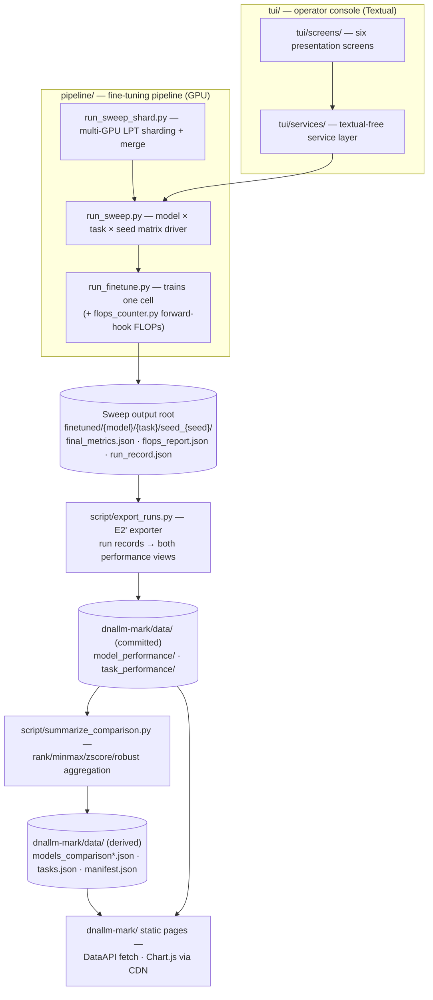

<!-- generated-by: gsd-doc-writer -->
# Architecture

## System overview

DNALLM-Mark is a DNA language-model benchmark platform built as four loosely coupled subsystems sharing one JSON data contract: a **GPU fine-tuning pipeline** (`pipeline/`) that trains 59 registered DNA LLMs (per `pipeline/models_info.json`) across 50 datasets (per `pipeline/datasets_info.json`) and measures training FLOPs via custom forward hooks; an **offline data chain** (`script/`, `scripts/`) that exports run records into per-model/per-task JSON and aggregates them into ranked leaderboard files; a **static web leaderboard** (`dnallm-mark/`) — plain ES-module JavaScript with no build step and no backend — that fetches the committed JSON at page load; and a **Textual TUI operator console** (`tui/`) for environment checks, data/model acquisition and selection, sweep launch, and live monitoring. The architecture is a batch-oriented pipeline: data flows one way from training artifacts through aggregation into committed static files that the website and TUI consume read-only. Reproducibility is enforced structurally — the aggregation chain is deterministic and byte-stable, and CI replays `make data` and fails on any drift in the committed data tree.

## Component diagram



## Layering

### 1. Fine-tuning pipeline (`pipeline/`, GPU-only)

Three levels of process composition, each layer spawning the next as a subprocess:

- **`pipeline/run_finetune.py`** — the leaf. Trains exactly one model on one task under one seed per invocation, delegating the training loop to the external [`dnallm`](https://github.com/zhangtaolab/DNALLM) package (`DNADataset`, `load_config`, `load_model_and_tokenizer`, `DNATrainer`). Before training it runs one no-grad calibration forward to measure per-layer FLOPs; after training it writes the per-cell artifacts `final_metrics.json`, `flops_report.json`, and the `trainer_state.json` resume marker (an existing marker makes the cell skippable). Model-quirk registries (safetensors, fp32-only, custom heads for `special_models`, etc.) are plain lists inside the `__main__` block. It also pre-scans `argv` to set `HF_HOME` before `huggingface_hub` imports.
- **`pipeline/run_sweep.py`** — the matrix driver. Enumerates the full model × task × seed matrix from the unified JSON registries (`models_info.json` keys × `datasets_info.json` entries with truthy `Train`) and launches one `run_finetune.py` subprocess per cell, with the child's cwd pinned to `pipeline/` and an absolute `--output_dir`. Per cell it writes `run_record.json` (status, verbatim suite-native metrics, git commit, timestamps); per sweep it writes `sweep_manifest.json` and `sweep_failures.json`. `--dry-run` plans without launching; `--priority-file` (`pipeline/sweep_priorities.json`) reorders tiers.
- **`pipeline/run_sweep_shard.py`** — the multi-GPU orchestrator. Launch mode partitions the requested models into N disjoint shards by **LPT** (longest-processing-time-first, weighted by registry `Model_size` — `lpt_shard()`), spawning one `run_sweep.py` per shard with `CUDA_VISIBLE_DEVICES` pinned and each writing to its own frozen sibling root `{output-root}-mgpu-w{i}`. Merge mode (`--merge`) unions worker roots into one verified consumer root: per-file copy + SHA256 re-hash verification over a data-artifact allowlist (`MERGE_ALLOWLIST`: run_record, final_metrics, trainer_state, seed_result, flops_report), manifest union with output paths rewritten, and lane-flag equality checks across workers. It composes by importing `run_sweep` as a sibling module — it never re-implements enumeration or argv building.

Supporting CPU-importable seams (importable without torch or dnallm installed):

- **`pipeline/flops_counter.py`** — `FlopsCounter` registers per-layer PyTorch forward hooks with class-name dispatch across ~20 attention/SSM/CNN architectures (BERT-style, Llama/Gemma GQA, BigBird, Hyena, Mamba/Mamba2, Caduceus, Enformer/Borzoi, megaDNA, …). `torch.nn` resolves through the lazy `_torch_nn()` seam so the CPU dev/CI lane can import and stub-test it. Reports carry `schema_version`, `uncovered_layers`, and an optional `hardware` section per `schemas/flops_report.json`.
- **`pipeline/registry_loader.py`** — the single official + custom registry overlay seam (custom files live under the user's XDG config dir, collisions fail fast, byte-identical to the official view when no overlay exists).
- **`pipeline/artifact_loader.py`** — tolerant JSON artifact reads returning a `None` sentinel on any parse-level failure.
- **`pipeline/env_smoke.py`** — structured `PASS:`/`FAIL:` environment kernels (torch/transformers pin checks, CUDA availability, dataset presence) behind the E2' launch gate.
- **`pipeline/dnallm_compat.json`** — the committed dnallm adaptation verdict map (59 model keys, 36 with `dnllm_adapted` true, stamped with the audited `dnallm_commit`; regenerated offline by `script/audit_dnallm_compat.py`). Read only through `tui/services/registries.py::load_dnallm_compat()` — the one tolerant loader, consumed by both the slot-2 model pool filter and the download queue's model channel resolution.

### 2. Offline data chain (`script/` + `scripts/`, CPU-only)

All runs go through the repo-root Makefile (`make data`), which replaced the former CWD-sensitive manual procedure:

1. **`script/export_runs.py`** (E2' regeneration) — reads `{root}/{model}/{task}/seed_{seed}/run_record.json` cells, maps metric keys through its single mapping table (`SUITE_CANONICAL` / `CANONICAL_TO_EXPORT` / `PIPELINE_KEYS` — the single metric-key authority, imported by `summarize_comparison.py`), joins the registries with hard-fail lookups, aggregates seeds with the vendored suite statistics, and emits **both** downstream views from one pass: the task view (`task_performance/{safe_task}_task_performance.json`, keyed task → model, per `schemas/task_performance.json`) and the per-model view (`model_performance/{model}_performance.json`, keyed model → task, per `schemas/model_performance.json`). Byte-stable output; the per-model view defaults to a sibling of the input root so committed data is never silently overwritten. Note: `task_performance/` (47 committed files) is currently static committed data — the legacy pivot script was retired, and this exporter is its regeneration path.
2. **`script/summarize_comparison.py`** (run with `cwd = dnallm-mark/data/`) — reads `model_performance/*.json` (45 files), computes four per-task normalizations for every model (rank score `N - rank`, min-max, z-score, robust median/IQR), sums them per model with no imputation for missing tasks, and writes `models_comparison.json` (all tasks), `models_comparison_{animal,plant,microbe}.json` (arena subsets), plus the `weighted_score` view (per-task z-scores ÷ full task count) and `manifest.json` (data-version stamp per `schemas/data_manifest.json`).
3. **`script/permutation_tests.py`** — pairwise permutation family over the z-scores → `permutation_tests.json`.
4. **`script/build_provenance.py`** — projects the registry's provenance columns → `provenance.{json,csv}`.
5. **`scripts/generate-tasks-index.js`** (Node, `__dirname`-relative) — scans `task_performance/` → the lightweight `tasks.json` index (per `schemas/tasks_index.json`).
6. **`script/gen_progress.py`** — serializes one or more sweep output roots into `dnallm-mark/data/progress/sweep.json` for the read-only progress page, importing the TUI's pure scanner (`tui/services/sweep_monitor.py`) as its single source of sweep state.

`make data` is deterministic: on a clean checkout it is a byte-identical no-op, which the CI `drift` job enforces with `git diff --exit-code -- dnallm-mark/data/`. Other committed data files in `dnallm-mark/data/` (e.g. `models_comparison_multi-species.json`, `n_audit.{json,csv}`) are maintainer-added artifacts outside the `make data` output set.

### 3. Static web leaderboard (`dnallm-mark/`)

No framework, no build step, no backend. Seven HTML pages each load one ES-module page-controller script; Chart.js 4.4.0 and SheetJS 0.18.5 arrive as jsDelivr CDN `<script>` tags:

| Page | Controller | Purpose |
|------|-----------|---------|
| `index.html` | `js/main.js` (`DNALLMMark`) | Scatter chart (FLOPs vs score) + sortable leaderboard, arena switching |
| `task.html` | `js/task-loader.js` + `js/task.js` (`TaskLoader`, `TaskBenchmark`) | Per-task model ranking, metric dropdown, bar chart |
| `finetuning.html` | `js/finetuning.js` (`FineTuningPage`) | Model × dataset results table with per-row parameter modal |
| `models.html` | `js/models.js` (`ModelsPage`) | Model card table |
| `datasets.html` | `js/datasets.js` (`DatasetsPage`) | Dataset metadata table |
| `submit.html` | `js/submit.js` (`SubmitPage`) | Client-side JSON validation + PR instruction generator |
| `progress.html` | `js/progress.js` (`ProgressPage`) | Read-only sweep progress mirror (fetch-once; reload = refresh) |

Shared leaves: `js/config.js` (app constants, arena list, view/sort options), `js/data.js` (`DataAPI` — the single fetch/memoize layer plus pure helpers), `js/navbar.js` (one config-driven navbar renderer for every page). Rendering is innerHTML template literals with event delegation on `document`; state is a single `this.state` object per class. ES modules require an HTTP origin — `start-server.sh` serves `dnallm-mark/` on `http://localhost:8080` via `python3 -m http.server` (production is equivalent static hosting).

### 4. Textual TUI console (`tui/`)

A strict two-tier split, enforced by an import-lock test (`tests/tui/test_import_lock.py`):

- **`tui/screens/` — presentation only.** Six top-bar navigation slots (defined in `tui/screens/nav.py::NAV_SLOTS`, Chinese resource-noun labels in `tui/strings.py`): 1 env check, 2 models, 3 datasets, 4 run config, 5 monitor, 6 about. Since the 2026-10-14 slot split, slot 2 (`selection.py`) is the **models-only** screen — the model table with the mark column, the compat column (dnllm-adapted officials by default, unadapted honestly revealed under the `t` ALL pool, customs always visible), the download column (a four-state vocabulary over live per-model disk presence), and `d` model download through the queue's model lane; dataset marks remain settable through presets and still display in the matrix. Slot 3 (`data_manager.py`) is the **datasets-primary** screen — the full official dataset list as the primary pane (missing-only view demoted to a `v` toggle), the persistent download queue rows with reconcile columns, and the Zenodo whole-package alternate riding the queue title row. Screens import textual freely, render state held by services, post user intent back, and run GPU/IO work in `@work(thread=True)` workers. Auxiliary surfaces: the custom-entry wizard modal family (`wizard.py`), the read-only matrix overview (`matrix.py`), and app-level help/min-size/exit modals in `app.py`. All operator copy comes from `tui/strings.py` constants.
- **`tui/services/` — textual-free orchestration.** Zero textual imports (directly or transitively), so every CPU lane can import it headless. Notable modules: `sweep_launcher.py` (the only execution tier — every launch is a `run_sweep.py` subprocess with the E2' typed-phrase gate, a detached tee log, and a live-sweep registry with kill/detach semantics), `sweep_monitor.py` (the pure artifact-tree scanner behind slot-5 monitoring and `script/gen_progress.py`), `download_queue.py` + `zenodo_bundle.py` (data acquisition — see below), `selection.py` / `run_config.py` / `templates.py` (run composition over `pipeline/sweep_priorities.json`), `env_check.py` / `env_gate.py` / `quick_check.py` (environment gating over `pipeline/env_smoke.py`), `custom_entries.py` / `custom_validation.py` / `gauntlet.py` (user-owned custom registry onboarding), `settings.py` (XDG state/config roots with atomic writes), `registries.py` (including `load_dnallm_compat()` — the one loader over `pipeline/dnallm_compat.json`), `about.py`.

**The download queue's three lanes.** `download_queue.py` runs one persistent five-state queue (pending / downloading / done / failed / mismatch) whose entries dispatch by `kind`:

- `dataset` — a `modelscope` CLI subprocess (LIST argv, `start_new_session=True`, env exactly `dict(os.environ)`); after exit 0 a landing gate (three split CSVs) and an automatic row-count reconcile subprocess decide done vs mismatch.
- `zenodo_bundle` — the whole-package alternate: stdlib HTTP (probe → record parse → streamed download → guarded extract → per-key reconcile), no modelscope CLI involved.
- `model` — the dnallm-authority lane: a `[sys.executable, "-I", "-c", MODEL_DOWNLOAD_PROGRAM, landing, repo_id]` child invoking `dnallm.models.model.download_model` with a functools.partial-bound modelscope `snapshot_download` (cache_dir rides the partial). The fixed `-c` program means no operator-controlled code ever crosses; after exit 0 the modelscope snapshot nesting is hoisted and the done gate requires `config.json` directly in the landing dir (no reconcile leg — models are not n_audit subjects). The service itself never imports dnallm or modelscope; the isolated child is the only place that code runs.

Landing-site agreement is structural: both storage bases resolve through the same chain the configured run consumes — constructor param (flag tier) > `run_config.resolve_dirs(run_config.load_state())` (the slot-4 tier, exactly what `compose_argv` threads into the sweep and what selection presence checks) > the repo `pipeline/` dir — read per call, never memoized, while the official registry read stays repo-anchored. A downloaded model or dataset therefore always flips the presence cell the operator was looking at.

**Hardening and structural pins.** Monitor and launcher were hardened around ambiguous-quit and stale-state edges: manual-root attach (`[a]`) validates through the `is_sweep_root` predicate and persists resolved-absolute, deduped roots; the launcher's live-sweep registry keys on `resolve_dirs(spec).output_root_abs` (the repo-root basis the sweep argv itself uses, never a raw cwd-relative root); the tee log opens `O_EXCL` (`"x"`) with a numeric-suffix fallback so same-second spawns never interleave; the app-level `ExitModal` carries every live root and kills/detaches all of them; and the monitor's `[r]` re-run derives its seed fan-out from the failure rows themselves (`derive_rerun_seeds()`), shared by both the confirm estimate and the launch so confirmed and executed GPU spend cannot drift. Two AST pins make the crash-safety discipline structural and future-proof: `tests/tui/test_work_site_hardening.py` requires every `@work` site in `tui/` to pass `exit_on_error=False` or own a broad internal guard (a raising worker otherwise exits the whole console), and `tests/tui/test_card_site_hardening.py` allowslists every `card`-field extraction site (each must keep an `isinstance` dict guard) so untrusted registry card values can never crash a screen read.

`tui/app.py` (`DnallmMarkTui`) is the composition root only: screen registry, app-level bindings, the shared download-queue driver worker, and a **Protocol-injection seam** — every service is constructor-injectable so tier-2 Textual Pilot tests run screens against deterministic fakes with no GPU, display, or artifact tree. The dependency direction is one-way, `tui → pipeline`: `tui/__main__.py` bootstraps `sys.path` with the repo root and `pipeline/` (a sys.path root, not a package) before importing `tui.app`, letting services import `env_smoke` / `registry_loader` / `artifact_loader` as top-level modules. Launch: `make tui` (`uv run --group tui --group gpu python -m tui`).

## Data flow

### Benchmark production (offline, GPU)

1. `run_sweep.py` (or `run_sweep_shard.py` across N GPUs) enumerates the matrix from the registries and, per cell, launches `run_finetune.py` with cwd `pipeline/`.
2. `run_finetune.py` loads config YAML, trains via `dnallm`, calibrates `FlopsCounter` on one forward pass, and writes `final_metrics.json` + `flops_report.json` + the `trainer_state.json` marker under `{output_root}/{model}/{task}/seed_{seed}/`.
3. The sweep driver records `run_record.json` per cell and the two root-level manifests; failures are isolated per cell (blind-except in the child, missing/invalid `final_metrics.json` fails the cell in the driver); completed cells are skipped on resume via the marker.
4. At merge time (multi-GPU), `run_sweep_shard.py --merge` unions worker roots with hash-verified copies into one consumer root.

### Aggregation → site data (offline, CPU)

5. `script/export_runs.py` maps the run records' suite-native metric keys, joins registries, aggregates seeds, and emits the task view (`task_performance/`) and per-model view (`model_performance/`).
6. `script/summarize_comparison.py` reads `model_performance/`, normalizes per task, aggregates per model per arena, and writes `models_comparison*.json` + `manifest.json`; `permutation_tests.py`, `build_provenance.py`, `generate-tasks-index.js`, and (for the progress page) `gen_progress.py` complete the derived set under `dnallm-mark/data/`.

### Web fetch (runtime, browser)

7. Each page's controller loads through `DataAPI` (`fetch('./data/...')` with in-memory memoization) or, on the task page, `TaskLoader` (LRU memory cache of 10 tasks, versioned `localStorage` entries with 24 h expiry, 3-attempt retry with backoff, idle preloading of adjacent tasks via `requestIdleCallback`). Charts render from the fetched JSON with Chart.js; spreadsheet export uses SheetJS. No client-side recomputation of aggregate scores — the weighted view is precomputed offline.

### TUI operational loop

The console closes the loop back into the pipeline: services read the same registries and committed artifacts, compose `run_sweep.py` argv, launch it detached through the `sweep_launcher` Popen seam, and the monitor screen polls the sweep output tree (2 s frontier / 60 s full-scan cadences, plus operator-attached manual roots) through the pure scanner — the same scanner that `gen_progress.py` serializes for the web progress mirror. Acquisition is the same loop one tier down: the download queue lands datasets (ModelScope CLI / Zenodo bundle) and models (the dnallm `-I` child) directly into the storage bases the run config and selection presence consume, so selection → download → launch → monitor forms one coherent operator path.

## The arena taxonomy

The `all / animal / plant / microbe` arena taxonomy is fixed and enforced at three points that must stay in sync:

1. **`dnallm-mark/js/config.js`** — `CONFIG.ARENAS` defines the four arena ids/names the UI offers.
2. **`dnallm-mark/js/data.js`** — `DataAPI.loadModelsComparisonByArena()` maps each arena id to its filename (`models_comparison.json`, `models_comparison_animal.json`, …).
3. **`script/summarize_comparison.py`** — the grouping authority is the human-verified `Category` column of `pipeline/datasets_info.json` (20 Animals, 15 Plants, 13 Microbe, 2 Multiple), never the result JSON's producer `species` string; `Multiple`-origin datasets resolve to their majority arena `Animals` via `MAJORITY_ARENA`, and `to_singular_species()` normalizes labels to singular lowercase filenames.

## Key abstractions

| Abstraction | File | Role |
|-------------|------|------|
| `FlopsCounter` | `pipeline/flops_counter.py` | Architecture-aware FLOPs accounting via per-layer forward hooks; lazy `torch.nn` seam keeps it CPU-importable |
| Cell artifact contract | `pipeline/run_finetune.py`, `pipeline/run_sweep.py` | `final_metrics.json` + `flops_report.json` + `trainer_state.json` resume marker + `run_record.json`; the marker is the only concurrency/resume guard |
| `lpt_shard()` / `worker_root()` / `MERGE_ALLOWLIST` | `pipeline/run_sweep_shard.py` | Disjoint multi-GPU partitioning, frozen worker-root naming (one authority for launch and merge), hash-verified artifact union |
| `registry_loader` | `pipeline/registry_loader.py` | Official + custom registry overlay; the single merge seam for all five registry consumers |
| `artifact_loader` | `pipeline/artifact_loader.py` | Tolerant JSON reads with a `None` sentinel for damaged artifacts |
| `resolve_dataset_metric` | `script/export_runs.py` | The single suite-registry → export-key metric mapping (imported by `summarize_comparison.py`) |
| `DataAPI` | `dnallm-mark/js/data.js` | The only fetch/cache layer for leaderboard data; also owns the model color palette and arena normalization |
| `TaskLoader` | `dnallm-mark/js/task-loader.js` | LRU + localStorage task caching, retry with backoff, idle preloading; exposed as `window.taskLoader` with a `window.DNALLMDebug` console API |
| Page-controller class | `dnallm-mark/js/*.js` | One class per page (`DNALLMMark`, `TaskBenchmark`, `FineTuningPage`, …) with the shared `init → setup → loadData → render* → bindEvents` lifecycle |
| Screens/services split | `tui/screens/`, `tui/services/` | Presentation-only screens over a textual-free service layer, wired through Protocol injection at the `tui/app.py` composition root |
| `DownloadQueueService` | `tui/services/download_queue.py` | The persistent five-state acquisition queue with three entry kinds (dataset ModelScope CLI, zenodo bundle, model dnallm `-I` child); landing bases resolve through the same run-config chain the sweep consumes |
| dnllm compat map | `pipeline/dnallm_compat.json` + `tui/services/registries.py::load_dnallm_compat` | The committed 59-key adaptation verdict map (36 adapted); one loader, two consumers (model pool filter + download channel resolution); an empty mapping is the degraded read, never a verdict |
| JSON Schemas | `schemas/*.json` | The machine-checked contracts coupling pipeline → scripts → UI (`model_performance.json`, `task_performance.json`, `models_comparison.json`, `flops_report.json`, `run_template.json`, …) |

## Directory structure

```text
dnallmmark/
├── pipeline/        GPU fine-tuning pipeline: run_finetune / run_sweep / run_sweep_shard,
│                    flops_counter, registries (models_info.json, datasets_info.json,
│                    dnallm_compat.json), config YAMLs, and the CPU-importable seams
│                    (registry_loader, artifact_loader, env_smoke)
├── script/          Offline Python data chain: export_runs, summarize_comparison,
│                    permutation_tests, build_provenance, gen_progress, plus audit/dev
│                    utilities (make_dev_splits, audit_n_frequencies,
│                    audit_dnallm_compat, …)
├── scripts/         Node one-off generators (generate-tasks-index.js)
├── dnallm-mark/     The static website: HTML shells, css/, js/ ES modules, and the
│                    committed data/ tree the pages fetch
├── tui/             Textual operator console: app.py composition root, screens/,
│                    services/, strings.py
├── schemas/         JSON Schema contracts for every artifact crossing a subsystem boundary
├── tests/           pytest suite (+ tests/tui/ Pilot + snapshot tests, tests/js/
│                    node:test lane); conftest.py mirrors the pipeline sys.path contract
├── docs/            Project docs (METHODOLOGY.md, ONBOARDING.md, multi-gpu.md, …)
├── baseline/        Pre-revision data fingerprints, pin-validation evidence, and the
│                    freeze_snapshot.py output lane (baseline/snapshots/)
├── benchmark/       README demo image
├── finetuned/       Default sweep output root (sweep manifests + per-cell run dirs)
├── finetuned-smoke/ Smoke-test sweep output root
├── logs/            Pipeline error logs
└── Makefile         Single-command lanes over the uv-managed environment
```

## Environments, lanes, and CI

Dependency management is uv with PEP 735 dependency groups (`pyproject.toml`, `uv.lock`, Python >= 3.13), split so CI never installs GPU or display-only packages:

| Group | Contents | Used by |
|-------|----------|---------|
| `data` (default) | pandas, numpy, scipy, evaluate | `make data`, the aggregation chain |
| `dev` | pytest, pytest-asyncio, ruff, ty, jsonschema | `make test`, `make lint`, `make typecheck` |
| `gpu` | torch 2.11.0 (cu130 index), transformers 5.17.0 | `make tui`, the pipeline; never CI |
| `tui` | textual (>=8.2,<9), platformdirs, jsonschema | `make tui`; textual-the-library also rides the CI test lane via `--group tui` |

Makefile lanes: `make data` (regenerate derived data), `make test` / `test-fast` / `ci` (pytest + node:test JS lanes), `make lint` (ruff), `make typecheck` (ty, with GPU imports substituted as `Any`), `make tui` (operator console), `make snapshot` / `snapshot-update` (baseline freeze and TUI SVG golden regeneration).

CI (`.github/workflows/ci.yml`, `pull_request` + push to `main`, every action pinned by commit SHA): a `lint-typecheck` job, a `test` job on Python 3.13 (3.14 as a non-blocking probe) plus the Node lane, a `static-js` job (`node --check` on all frontend/tool JS, ESLint and html-validate as exact-version `npx` pins over the six real page shells), and the `drift` job proving `make data` is a byte-identical no-op over the committed data tree. The pytest suite collects 1,759 tests (1,743 passing + 9 strict-xfail TUI SVG golden pins at the 2026-10 verified baseline), including the AST structural pins over the TUI tier (`@work` never-exit, card-extraction allowlist, import lock).
