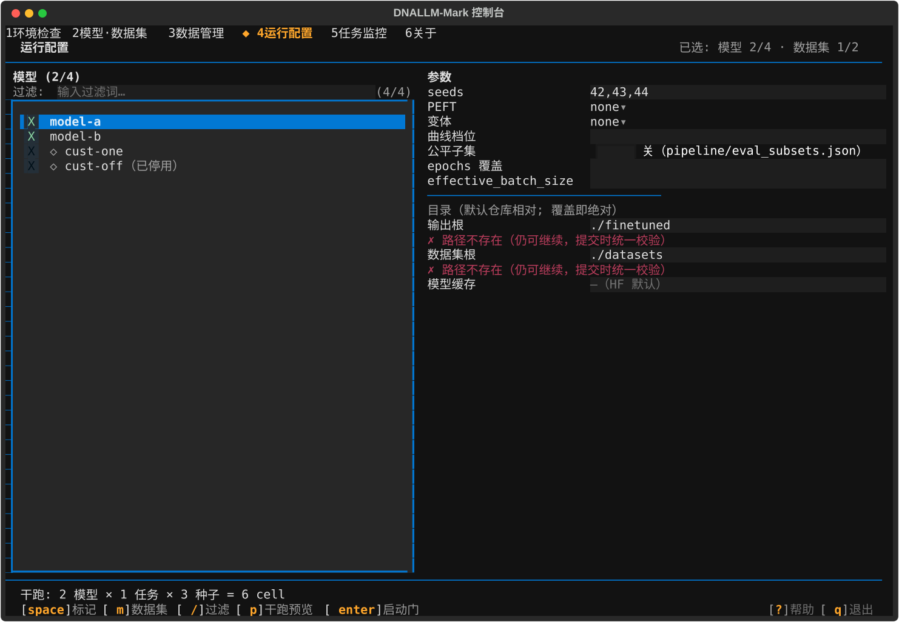

<!-- generated-by: gsd-doc-writer -->
# Getting Started

This guide is the shortest path from a fresh clone to a verified environment and a running local leaderboard. Everything here runs on a CPU-only machine — no GPU is needed for the data chain, the test suite, or the web UI. See [ARCHITECTURE.md](ARCHITECTURE.md) for how the subsystems fit together and [CONFIGURATION.md](CONFIGURATION.md) for every dependency group, Makefile lane, and pipeline knob.

## Features and components

Four subsystems share one JSON data contract (the full component map and data-flow walkthrough is [ARCHITECTURE.md](ARCHITECTURE.md)):

| Component | What it does |
|-----------|--------------|
| Fine-tuning pipeline — `pipeline/` | `run_finetune.py` trains exactly one model × task × seed cell (delegating the loop to the external `dnallm` package and measuring FLOPs via `flops_counter.py` forward hooks); `run_sweep.py` drives the model × task × seed matrix, one subprocess per cell; `run_sweep_shard.py` orchestrates multi-GPU runs (LPT sharding, `--mode dispatch` shared root, hash-verified `--merge`) |
| TUI operator console — `tui/` | Six screens (`tui/screens/`) over a textual-free service layer (`tui/services/`): environment checks, ModelScope-first model/dataset acquisition, the gated sweep launch, live multi-GPU monitoring |
| Offline data chain — `script/`, `scripts/` | `export_runs.py` turns sweep run records into the two performance views; `summarize_comparison.py`, `permutation_tests.py`, `build_provenance.py`, and `generate-tasks-index.js` derive every leaderboard file (the `make data` lane) |
| Web leaderboard — `dnallm-mark/` | Static ES-module pages (no build step, no backend) that fetch the committed JSON at load time; Chart.js and SheetJS arrive via CDN |

## Prerequisites

| Tool | Version | Why you need it |
|------|---------|-----------------|
| Python | 3.13+ (`.python-version` pins `3.13`) | The data toolchain and test suite (`requires-python = ">=3.13"`) |
| [uv](https://docs.astral.sh/uv/) | any recent (repo developed against 0.12.x) | Dependency management; every Makefile lane runs through `uv run`, which auto-syncs `.venv` from the committed `uv.lock` |
| Node.js | >= 18 | The JS test lane (`make test`), the `tasks.json` index generator (`make data`), and the optional `npx http-server` fallback. The web UI itself is static and needs no Node |
| Git | any | Cloning the repository |

Notes:

- uv reads `.python-version` and resolves Python 3.13 for the project environment — you do not need to pre-install that exact interpreter.
- The leaderboard pages load Chart.js, SheetJS, and Google Fonts from CDNs at render time, so the browser needs internet access for full function.
- The GPU fine-tuning pipeline has additional requirements (the external `dnallm` package, `torch`/`transformers` from the `gpu` group, and the benchmark assets — a 59-model / 50-dataset registry). Acquisition is **ModelScope-first and TUI-driven** (see the console section below); manual placement into `pipeline/datasets/` and `pipeline/models/` is now the alternate route, required only for the 23 registry models not marked dnllm-adapted. None of that is needed for this guide — see the README's "Datasets and Models Preparation" section when you get there.

## Installation

```bash
# 1. Clone
git clone https://github.com/zhangtaolab/dnallmmark.git
cd dnallmmark

# 2. Install the data toolchain (creates .venv from the committed uv.lock)
uv sync
```

`uv sync` installs only the `data` dependency group — `default-groups = ["data"]` in `pyproject.toml` deliberately replaces uv's `["dev"]` default. Expected output ends with a line like `Resolved N packages, installed M packages in S`. The dev tools (`pytest`, `ruff`, `ty`, `jsonschema`) are not installed by this step; the `make` targets below pull them on demand via `uv run --group dev`.

## First run

Three commands, in order, take you from clone to a running leaderboard. All run from the repository root.

### 1. Verify the derived data is byte-stable (the drift invariant)

```bash
make data
git status --porcelain dnallm-mark/data/ DATA.md
```

`make data` regenerates the entire derived-data chain from the committed inputs (`script/summarize_comparison.py` → `script/permutation_tests.py` → `script/build_provenance.py` → `node scripts/generate-tasks-index.js`). On an untouched clone it is a **byte-identical no-op** — the `git status` line must print nothing. This is the repository's core reproducibility guarantee; CI's `drift` job runs exactly this check on every pull request.

Expected output includes lines like:

```
✅ Global comparison results saved to: models_comparison.json
✅ Data manifest saved to: manifest.json (data_version 1.1.0)
🎉 All statistical comparisons generated successfully!
Found 47 task files
✓ Generated tasks.json with 47 tasks
```

### 2. Run the test suite (both lanes)

```bash
make test
```

Runs the Python lane (`uv run --group dev --group tui pytest`) and the Node lane (`node --test tests/js/`, zero npm dependencies). Expected shape of output (counts grow as the suite grows):

```
============ 1743 passed, 9 xfailed in ~5 min ============                        # Python lane (xfails: strict SVG goldens)
ℹ pass 26                                                                     # Node lane summary
```

### 3. Serve the leaderboard

```bash
bash start-server.sh
```

Then open <http://localhost:8080>. Expected output:

```
Starting DNALLM Mark server...
Server URL: http://localhost:8080
Press Ctrl+C to stop the server
```

`start-server.sh` serves `dnallm-mark/` via `python3 -m http.server 8080` (falling back to `python`, then `npx http-server`). The ES-module UI requires an HTTP origin — opening the HTML files via `file://` does not work.

### Optional: the TUI operator console (the acquisition route)

```bash
make tui
```

This launches the Textual console (`uv run --group tui --group gpu python -m tui`) for environment checks, model/dataset selection, **downloads**, sweep launch, and live monitoring. Six digit-keyed screens (UI copy renders in Chinese or English — the default is English, `L` toggles live): `1` environment check, `2` 模型 (models), `3` 数据集 (datasets), `4` run config, `5` monitor, `6` about. The full key-by-key runbook is [TUI-GUIDE.md](TUI-GUIDE.md).

#### The launch journey, key by key

The steps below are the shape of the recorded quick-261022-pa6 session — a real 2 models × 2 tasks × seed 42 dual-GPU launch whose full evidence trail is [live/RECORD.md](live/RECORD.md) (4/4 cells, driver exit 0, ~56 minutes end to end). The first three captures are the deterministic SVG snapshot goldens the test suite pins; the last is that real run's own monitor. Every key named here comes from the `BINDINGS` declarations in `tui/screens/`.

1. **Boot — `make tui`.** The console opens on slot `1` 环境检查 (environment check) and runs the eight env kernels in a background worker (a same-day restart renders the cached verdict instantly). Read the verdict line: `✓ 环境就绪（可启动）` clears the way, while `✗ 关键项未通过` names the failing critical kernels and blocks every slot-4 launch until fixed. On this screen: `r` re-runs all kernels, `enter` opens a row's drill-down.

    

2. **Compose the run — press `4` (运行配置 / run config).** The left pane is slot 4's own picker: `space` toggles the mark on the cursor row, `m` flips the picker between models and datasets, `/` focuses the filter (`esc` clears it). Marks live in the persistent run spec, so they survive restarts. The recorded session marked 2 models, pressed `m`, and marked 2 datasets.

3. **Set parameters (right pane).** `seeds` defaults to `42,43,44`; PEFT and 变体 (variant) are choice rows — `enter` opens the radio modal; epochs / effective_batch_size / batch_size are optional overrides; the 多 GPU 调度 section carries `workers` (live default `1`) and `GPUs` (empty = the dispatcher binds GPUs `0..workers-1` at launch). The 高级参数 section is collapsed by default: `a` expands its advanced rows, `r` restores their defaults.

    

4. **Preview — `p`.** The 干跑预览 modal shows the same-source enumeration counts and, on a clean spec, the exact `run_sweep_shard.py --mode dispatch` argv verbatim — composed by the same code the launcher routes through, so what you read is what launches. On problems it renders them as a numbered list instead.

5. **Launch gate — `enter`.** The 启动确认 (launch confirmation) modal recomputes everything fresh through the services — never the preview line's cache: the counts formula (in the golden: `2 模型 × 1 任务 × 3 种子 = 6 训练项 → ./finetuned`), the planned model × dataset pairs, and the confirm line. **`y` launches, `n`/`esc` cancel — `enter` is deliberately inert on the confirm.** Only a full official re-run (all 59 models × 50 datasets × ≥ 3 seeds) escalates to the E2' typed-phrase modal: type the output root's final directory name, `enter` arms the confirm, then `y` launches.

    

6. **Monitor — the console switches to slot `5` (任务监控) by itself after `y`.** The new sweep is auto-attached. Keys: `enter` attaches the cursor's discovered sweep (or drills into an entry's per-seed detail), `f` failures, `t` log tail, `a` attaches a manual root by path, `r` forces a full rescan, `k` kills a TUI-spawned sweep. The capture below is the real run's tail: the attached `finetuned-tui-pa6` root at 3/4 cells, the dispatch line (`dispatch running · 3/4 done · queue 0`), and one row per worker — GPU 0 idle while GPU 1 finishes the long last cell; the sweep completed 4/4 about a minute later.

    

Model and dataset acquisition is ModelScope-first through the console:

- **Slot `2` (models)** — the model table's `d` key downloads the cursor's model through the dnllm channel (`dnallm.models.model.download_model` in an isolated child process). Only the 36 dnllm-adapted registry models are downloadable; the other 23 rows toast the manual-placement landing directory instead.
- **Slot `3` (datasets)** — per-dataset downloads default to the ModelScope channel (`d` enqueues the cursor's dataset, `a` enqueues all missing); the Zenodo whole-package bundle is the demoted alternate (`z`), riding the queue title row.
- Downloads land under the **effective storage roots** — CLI flag > `directories.json` > the repo `pipeline/` defaults — the same chain the configured sweep consumes, so a landed download immediately flips the presence cell the operator was looking at. See [CONFIGURATION.md](CONFIGURATION.md) for the `directories.json` format and the full resolution chain.
- Download prerequisites: the `modelscope` console script ships in the `data` dependency group — `uv sync` installs it (the queue resolves the venv sibling first, then falls back to `PATH`); model downloads still additionally need the external `dnallm` package (a manual install from the local sibling clone).

Caveats:

- It installs the `tui` **and** `gpu` groups — including `torch` — on first run.
- Full function (the env panel's CUDA checks, sweep launches) expects a CUDA GPU workstation; on a headless dev box the console still launches but environment checks will report failures honestly. The console needs a terminal of at least 80x24.
- Headless development does not need this lane at all: the TUI's screens and services are tested without a display, GPU, or `dnallm` by the Textual Pilot tests inside `make test`.

## Everyday commands per lane

| Command | Lane | What it does |
|---------|------|--------------|
| `make test-fast` | fast dev loop | pytest excluding the `slow` marker; also the escape hatch on machines without Node (node-dependent tests are skipped) |
| `make ci` | CI selection | the pinned lane CI replays (`pytest -m ci`): golden replay, metric-key parity, species spot checks, aggregation units |
| `make data` | data chain | regenerate every derived file under `dnallm-mark/data/` (see above) |
| `make test` | full suite | pytest including `slow`, plus the Node JS lane |
| `make lint` | static checks | `ruff check` over `tests/` plus the fixed-findings file list in the Makefile |
| `make typecheck` | static checks | `ty check` over `script/`, `baseline/`, `tests/`, `scripts/`, `pipeline/`, `tui/` |
| `make tui` | display runtime | the operator console — env checks, ModelScope-first model/dataset downloads, sweep launch, monitoring (see above) |
| `make snapshot` | maintainer | freeze the derived-data set into `baseline/snapshots/` (tar + SHA-256 manifest) |

All targets accept `make UV=/path/to/uv` if your uv install is not on `PATH`.

## Where the data lives

All leaderboard data lives under `dnallm-mark/data/`, committed to the repository and fetched by the web pages at load time:

| Path | Role |
|------|------|
| `model_performance/` | **Input** — one `{model}_performance.json` per model (per-model view of results) |
| `task_performance/` | Committed static per-task files (`{dataset}_task_performance.json`); their regeneration path is the unified exporter `script/export_runs.py`, which consumes sweep run records |
| `models_comparison.json`, `models_comparison_{animal,plant,microbe}.json` | **Generated by `make data`** — ranked aggregates (rank score, MinMax/z-score/robust sums, FLOPs) consumed by the main leaderboard |
| `tasks.json` | **Generated by `make data`** — lightweight task index for the task benchmark page |
| `manifest.json`, `permutation_tests.json`, `provenance.{json,csv}` | **Generated by `make data`** — data-version stamp, pairwise permutation tests, registry provenance |
| `progress/` | Sweep progress mirror for the read-only progress page |

`task_performance/` and `model_performance/` are inputs to (not outputs of) the `make data` chain today. Regenerating derived files is a maintainer step, never part of serving the site.

## Common setup issues

- **`make test` or `make data` fails with "node >=18 required..."** — Node.js is a hard dependency of both lanes (the JS suite, the `tasks.json` goldens, and the index generator). Install Node >= 18, or use `make test-fast` (pytest-only; it skips node-dependent tests when node is absent).
- **Opening `dnallm-mark/index.html` directly shows an empty page** — the UI is ES-module JavaScript fetching `./data/...`; it needs an HTTP origin. Serve it with `bash start-server.sh` instead of `file://`.
- **Charts or fonts do not render** — Chart.js, SheetJS, and Google Fonts load from CDNs. The UI degrades without internet access at page render.
- **`make: uv: Command not found` (Error 127)** — your uv install lives outside the locations on `PATH`. Run `make UV=/path/to/uv <target>`.
- **`make data` shows a diff on a fresh clone** — do not commit it; report it. On an untouched checkout regeneration must be byte-identical, so a diff means the environment resolved different package versions than `uv.lock` pins (e.g. Python < 3.13) or the checkout is not clean.
- **`make tui` installs torch but the env screen reports failures** — expected on machines without CUDA; the console's environment checks are honest. Full TUI function targets a GPU workstation.
- **Slot 3 dataset download toasts `cli_unavailable`** — the per-dataset ModelScope channel shells out to the `modelscope` console script (`python -m modelscope` does not work — it has no `__main__`). Re-run `uv sync` — modelscope ships in the pyproject data group and the queue resolves the venv sibling next to the interpreter first; a CLI elsewhere on `PATH` also works.

## Next steps

- [ARCHITECTURE.md](ARCHITECTURE.md) — how the pipeline, data chain, web UI, and TUI fit together
- [CONFIGURATION.md](CONFIGURATION.md) — dependency groups, Makefile lanes, pipeline YAML/CLI flags, `directories.json` storage roots, environment variables
- [TUI-GUIDE.md](TUI-GUIDE.md) — the operator console runbook: every screen, key, gate, and troubleshooting entry
- [METHODOLOGY.md](METHODOLOGY.md) — how the leaderboard numbers are computed
- [ONBOARDING.md](ONBOARDING.md) — checklists for adding a new model or dataset to the benchmark
- [multi-gpu.md](multi-gpu.md) — multi-GPU sweep orchestration: dispatch mode, the 5% subset workflow, and the legacy static track
- [DEVELOPMENT.md](DEVELOPMENT.md) and [TESTING.md](TESTING.md) — local development setup, code style, and the test lanes
- The README's Documentation index — the full list including TUI, data-audit, and audit reports
