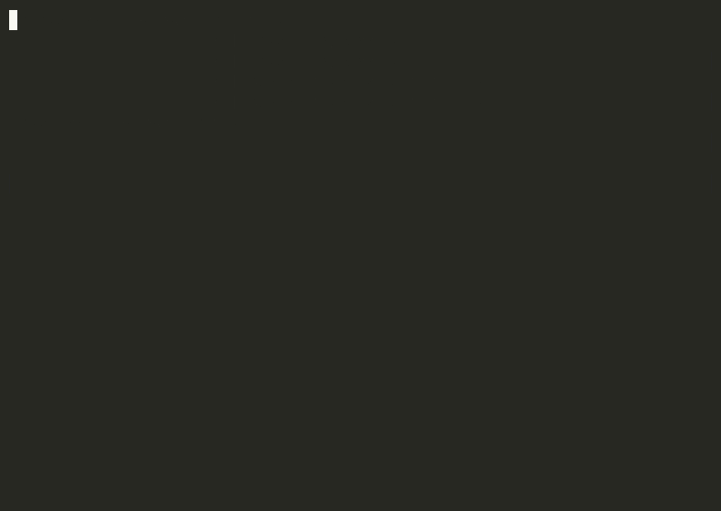

<!-- generated-by: quick-261015-pex (scripts/demo/record_tui_demo.py + record.sh); anchors + footage regenerate from tui/strings.py and the live presence scan -->
# TUI Demo — The Operator Journey, Recorded on Real Tasks

This is the recorded walkthrough of the DNALLM-Mark operator console: sections 1–10 embed GIFs of the **real console driving real work** on the recording machine — a real environment check, real ModelScope downloads, a real (bounded) `plant-dnabert-6mer × iDNA_ABF_datasets__5mC` training through the y-confirm launch confirmation, live monitoring, a real kill, and a from-failures re-run driven to completion. Section 11 — the multi-GPU surfaces that shipped after this recording pass — is the one exception: it references the shipped screens and their SVG snapshot goldens, with its bilingual GIF explicitly queued. There is no mockup anywhere in this document: the numbers, gates, and guardrails visible in the GIFs are the production behaviors (EHC-1..4) — the same code paths the [TUI guide](TUI-GUIDE.md) documents.

Every section ships **two recordings**: the `en` GIF boots in the default English; the `zh` GIF reaches 中文 by pressing `L` on camera (the live toggle is itself demo footage) and restores the boot language before the recording ends.

**How the footage was made.** A deterministic pexpect scene driver (`scripts/demo/record_tui_demo.py`) spawns the real console (`uv run --group tui --group gpu python -m tui`) on a 100×30 pty, relays every rendered byte verbatim, and waits on anchors derived from `tui/strings.py`. `asciinema rec` wraps the driver; `agg` renders the GIF. No browser is involved anywhere in the chain. Download targets were chosen by a **live presence scan** (registry × disk × `pipeline/dnallm_compat.json`) at recording time — never hardcoded. The per-recording honesty ledger — real target keys, resets applied before spawn, sizes, dates — is [`docs/demo/RECORDED.md`](demo/RECORDED.md); everything below restates only what that ledger and the casts actually show.

One trust note: the demo sweeps write only to the gitignored `finetuned/demo` and `finetuned/demo-fail` output roots (nested under the monitor's default scan root so the discovered table lists them natively). The real `pipeline/finetuned` tree is never written.

## 1. Environment check

| English | 中文 |
|---|---|
|  |  |

Each recording boots the console with a **fresh state directory**, so the eight environment kernels (`version_pins`, `dnallm`, `peft`, `cuda`, `matmul`, `numpy`, `model_dirs`, `dataset_dirs`) run live on camera; `r` re-runs them, and `enter` drills into a row's verbatim detail. The verdict block is what the slot-4 launch confirmation enforces.

| Key | Action |
|-----|--------|
| `r` | Re-run every kernel |
| `enter` | Open the cursor row's drill-down |

Full key map and the verdict semantics: [Screen 1 — Environment check](TUI-GUIDE.md#screen-1--environment-check-环境检查).

*What actually happened:* on this box `model_dirs` honestly reports the models that are absent (they are placed by hand — the routing hint names it), and the verdict passes with the six critical kernels green.

## 2. Selection, presets, and the presence matrix

| English | 中文 |
|---|---|
|  |  |

The k9s-style type-to-filter (`/` + `plant-dnabert`), `space` marks on the filtered family rows, the registry-grammar filter (`species:plants`), the preset picker (`p` — tier-1 E2E pairs applies and closes), saving the current marks as a named preset (`s` — `demo-walkthrough`, landing on the overwrite confirm on the second recording because the name already existed), and the read-only 59×50 presence matrix (`v`) with marks shown as `◆` prefixes.

| Key | Action |
|-----|--------|
| `space` | Toggle the cursor row's mark |
| `/` | Focus the filter (registry grammar: `species:`, `type:`, `size:` …) |
| `p` | Preset picker (apply replaces the mark sets) |
| `s` | Save the current marks as a named preset |
| `v` | Push the presence matrix |

Full key map: [Screen 2 — Models](TUI-GUIDE.md#screen-2--models-模型).

*What actually happened:* the marks land on the real `plant-dnabert` family keys; the saved preset persists under the real XDG config root (which is why the zh recording hits the overwrite confirm — an honest second-run artifact).

## 3. Model download (slot 2 `d`)

| English | 中文 |
|---|---|
|  |  |

`d` on a missing **dnallm-adapted** model enqueues it through the shared queue's dnallm channel (`dnallm.models.model.download_model` over a ModelScope snapshot downloader); the 下载 column flips to the live queue state and, when the transfer streams long enough, composes the parsed integer percent and the EHC-4 transfer rate; a finished download flips the cell to ✓ 已下载 / ✓ downloaded.

| Key | Action |
|-----|--------|
| `d` | Download the cursor's adapted model (ModelScope channel) |
| `t` | Reveal unadapted official entries (pool toggle) |

Full guard chain (already-downloaded / manual-placement / unknown toasts): [Screen 2 — Models](TUI-GUIDE.md#screen-2--models-模型).

*What actually happened:* the live scan picked `caduceus-ph_seqlen-131k_d_model-256_n_layer-16` (the smallest missing adapted model at recording time, 8M parameters); the download completed so fast on the maintainer's ModelScope mirror that the percent/rate ticks coalesce — the column vocabulary and the finished flip are the real render, and RECORDED.md says exactly that.

## 4. Dataset download and the queue (slot 3 `d`)

| English | 中文 |
|---|---|
|  |  |

`v` toggles the missing-only view; `d` enqueues the cursor's dataset through the per-dataset ModelScope channel; the queue table carries the serial state machine with live percent + progress bar (+ rate when it parses), and the reconcile column compares the registry-declared row counts against the measured ones — presence flips to ✓ exactly when a download lands and reconciles.

| Key | Action |
|-----|--------|
| `v` | Toggle the full list / missing-only view |
| `d` | Enqueue the cursor's dataset (ModelScope default channel) |
| `enter` | Drill-down: download argv, state, reconcile numbers, log lines |

Full key-target contract (incl. `r` retry / `x` cancel / `g` re-audit): [Screen 3 — Datasets](TUI-GUIDE.md#screen-3--datasets-数据集).

*What actually happened:* the recording box had **all 50 datasets present**, so the reset lever the re-record section documents was applied before recording — the `iPro-WAEL_datasets/Promoter_R_capsulatus` task directory was removed and the committed `n_audit` regenerated (33 s), making the absence truthful. The recording then downloads it back for real: the reconcile column shows `✓ 10581 rows match` and the presence summary returns to `present 50/50`. The same fast-mirror note as section 3 applies to the percent ticks.

## 5. Run config and the live preview (slot 4)

| English | 中文 |
|---|---|
|  |  |

Composing the run: the picker `m` flip between models and datasets, filter marks on `plant-dnabert-6mer` and `iDNA_ABF_datasets__5mC`, the seeds edit to `42,43`, the epochs override to `1`, and the output root typed to the demo root — then `p` opens the dry-run preview modal with the **verbatim `run_sweep.py` argv** (the typo-guard: the argv on camera names the demo root, never the real one).

| Key | Action |
|-----|--------|
| `space` / `m` | Mark a picker row / flip models ↔ datasets |
| `p` | Dry-run preview modal (counts + the exact argv) |
| `enter` | Open the launch confirmation (next section) |

Full params pane: [Screen 4 — Run config](TUI-GUIDE.md#screen-4--run-config-运行配置).

*What actually happened:* the preview line re-derives on every keystroke (`Dry run: 1 models × 1 tasks × 2 seeds = 2 cells`), and the modal's argv carries `--num_train_epochs 1` and the demo output root exactly as launched in section 6.

## 6. The launch confirmation, y-confirm, monitoring, and the kill

| English | 中文 |
|---|---|
|  |  |

The gated launch of the bounded demo training (`plant-dnabert-6mer × iDNA_ABF_datasets__5mC`, seeds `42,43`, 1 epoch, output root `./finetuned/demo`): `enter` opens the gate, the confirm modal shows the enumeration (`1 models × 1 tasks × 2 seeds = 2 cells → …`), **`enter` is shown inert first** (EHC-2 — a stray double-enter can never start GPU work), then `y` launches. The console auto-switches to the monitor with the sweep attached (the live `Done 0/2` stats line), `t` streams the training log, `f` shows the failures modal (empty mid-run), and a second gated attempt while the sweep is live is **refused at stage 0 by the single-GPU serialization guard** (EHC-3) naming the running root. Finally `q` pushes the exit modal and `k` SIGTERMs the sweep — the kill lands mid-seed-42.

| Key | Action |
|-----|--------|
| `enter` | Open the launch confirmation (from the picker) |
| `y` | Confirm the launch (the only key that can) |
| `n` | Cancel the launch confirmation (2026-10-16 UX round — the confirm modal now also lists the planned 模型 × 数据集 pairs under the counts formula; both postdate this recording) |
| `t` / `f` | Log-tail modal / failures modal |
| `q` → `k` | Exit modal → kill the live sweep and quit |

Full confirmation pipeline and the E2' typed-phrase escalation: [The launch confirmation and the E2' trust boundary](TUI-GUIDE.md#the-launch-confirmation-and-the-e2-trust-boundary).

*What actually happened (honest limits, WINDOWS #26/#27):* the recording machine's console reliably stops processing input ~60 s after a launch (around the first cell's completion output burst), which makes two planned moments unreachable on this box — folding seed 42 to `1/2` before the kill, and carrying a second in-session launch. The recording therefore kills mid-seed-42 (`0/2` running), and the fast-failure sweep that feeds section 8's re-run was produced off-camera through the maintainer CLI surface (`run_sweep.py` on the reset dataset) before the recording booted — RECORDED.md documents that prep on the launch rows.

## 7. The from-failures re-run

| English | 中文 |
|---|---|
|  |  |

The monitor attaches (`a` + path, or `enter` on a discovered row) to the fail root carrying the **real failure record** — `plant-dnabert-6mer × iPro-WAEL_datasets__Promoter_R_capsulatus × seed 42` (`executor exited 0 but final_metrics.json is missing`). `f` lists it; `r` opens the re-run confirm (the planned-cell estimate, with `enter` shown inert — EHC-2 applies to re-runs too); `y` launches `--from-failures` at the sweep's own root. Because the dataset-download section restored the dataset, the failed cell **retrains for real** and folds to done.

| Key | Action |
|-----|--------|
| `a` / `enter` | Attach a root path / attach a discovered row |
| `f` | Failures modal over the attached root |
| `r` → `y` | Re-run the failures (gated like slot 4) |

Full monitor key map: [Screen 5 — Monitor](TUI-GUIDE.md#screen-5--monitor-任务监控).

*What actually happened:* the en recording watches the full retrain (the stats line resets `Done 1/1 → 0/1`, the current cell runs, then folds back); the same real journey runs in 中文. The SIGTERM-killed-root question from the plan is answered by design: a TUI kill writes no failure record (the sweep dies with the group), so the failures source here is the deliberately-failing sweep, not a killed one.

## 8. The language toggle (`L`)

| English | 中文 |
|---|---|
|  |  |

`L` toggles zh ↔ en live: every mounted screen re-renders, the bars/footer/help labels follow, and the choice persists to `language.json` so the next boot starts in it. The recordings show the toggle in both directions and one navigation in the toggled language; each recording restores the boot language (English) before quitting.

| Key | Action |
|-----|--------|
| `L` | Toggle the UI language (needs the unfocused screen) |

Semantics and the persistence contract: [The shell: global keys](TUI-GUIDE.md#the-shell-top-bar-bottom-bar-global-keys).

## 9. The onboarding wizard (`w`)

| English | 中文 |
|---|---|
|  |  |

The dataset wizard on slot 3 (`w`): real field edits (the key, a real dataset path with its live advisory), `enter` advances, `b` goes back, and `esc` on a filled form lands on the discard confirm (a plain confirm — `enter` discards). The model wizard on slot 2 opens, advances one step, and a blank form cancels silently. Neither recording lands an entry — the demo custom entry used by section 10 already exists.

| Key | Action |
|-----|--------|
| `w` | Open the onboarding wizard (dataset on slot 3, model on slot 2) |
| `enter` / `b` | Next step / previous step |
| `esc` | Cancel (confirm when values are filled) |

The full step/field map and the gauntlet: [Screen 2 — Models](TUI-GUIDE.md#screen-2--models-模型) and the wizard's own sections of the guide.

*What actually happened:* the recording box carried no custom entries, so the `demo-custom-model` entry (the section-10 subject) was landed **before recording** through the real onboarding write seam (`tui.services.custom_entries.land`) carrying the `plant-dnabert-6mer` card's own field values — RECORDED.md documents that prep on the wizard rows.

## 10. Custom entry management (`e` / `w`)

| English | 中文 |
|---|---|
|  |  |

On the real custom row (`demo-custom-model`): `e` disables it — the toast states the loader-level effect and the row carries the disabled suffix — then `e` again **restores it on camera** (PEX-3: the real config root's state is returned to what it was). `w` on the custom row opens the wizard **prefilled from that entry** (edit = re-record); `esc` discards.

| Key | Action |
|-----|--------|
| `e` | Toggle the cursor custom entry's enabled state |
| `w` | Open the wizard prefilled (on a custom row) |

Full semantics (disabled marks blocked, badge/suffix vocabulary): [Screen 2 — Models](TUI-GUIDE.md#screen-2--models-模型).

*What actually happened:* the entry stays enabled at the end of both recordings — the disable is undone on camera, and the wizard edit is discarded without landing.

## 11. Multi-GPU dispatch: launch and monitoring

This section has no GIF table — the honest variant of the precedent shape. The visual record is the committed SVG snapshot goldens (deterministic 120×40 renders of the real screens) plus the shipped screens themselves:

| Scene | Where to see it |
|---|---|
| Slot-4 params pane with the 多 GPU 调度 section (`workers` / `GPUs` fields) | `tests/tui/__snapshots__/run_config.svg` |
| The confirm face with its 调度计划 dispatch-plan preview line | `tests/tui/__snapshots__/run_config_confirm.svg` |
| Monitor Running card with dispatch rows + the GPU 状态 G GPU-lanes panel | `tests/tui/__snapshots__/monitor_running.svg` |

*A bilingual GIF re-record for this section is queued post-milestone: recording one needs a new scene driver in `scripts/demo/record_tui_demo.py` (the ten existing scenes predate multi-GPU) plus a real dual-GPU dispatch run — a code-plus-GPU change deliberately out of scope for the docs phase. See [Re-recording any GIF](#re-recording-any-gif) for the machinery the re-record will use.*

**Launch (slot 4).** The params pane carries a 多 GPU 调度 / Multi-GPU dispatch section — a `workers` field (live default `1`) and a `GPUs` field whose empty placeholder reads `—（默认: GPU 0..workers-1）`: an unset GPUs field threads no `--gpus` flag, and the dispatcher binds the FIRST `workers` GPU indices at launch time. Every slot-4 launch composes `run_sweep_shard.py --mode dispatch --workers N` (plus `--gpus 0,1` only when typed) with the existing pass-through vocabulary; `p` shows the composed argv verbatim, and the confirm face adds one dispatch-plan preview line above the pair list — `调度计划: 2 workers × GPUs 0,1 · 排队 6 训练项（预览）` — naming the workers, the resolved GPUs (the typed list, or `0..N-1` under the default rule), and the queued-cell count. The gate chain order is unchanged (problems → env preflight → confirm, with the E2' typed phrase at full scope); the old single-GPU serialization stage became multi-GPU capacity arithmetic — the launch refuses when the live registry's demand plus the requested workers exceeds the machine's effective GPU count, rendering `⚠ GPU 容量不足 …` with the live roots and both counts. Input problems mirror the shard CLI: `workers` must be an integer ≥ 1, GPUs comma-separated non-negative integers, and `workers` may not exceed a typed GPU list's length.

**Monitoring (slot 5).** The Running tab renders dispatch runs natively. A running card whose root carries `dispatch_state.json` gains a dispatch line — `调度 running · 完成 12/36 · 队列 21` (status verbatim from the state file, done/total, queue depth) — plus one row per worker in array order: `worker 0 · GPU 0 · ⏵ plant-dnamamba-6mer × GUE__emp_H3 × seed_42` when busy, `worker 1 · GPU 1 · ◌ 空闲` when idle. Both read on the 2-second frontier cadence. When the state file's age crosses the cell-scale grace (`DISPATCH_STALE_SECONDS` = 3600 s, maintainer-tunable), a `⚠ 调度状态过期` marker renders above the dispatch line while the last-known-good rows stay; a parseable snapshot that violates the schema's count invariant renders its own distinct ⚠ marker. Below the tab content — on BOTH tabs, with no key of its own — stands the GPU 状态 / GPUs G GPU-lanes panel: one lane per GPU (`GPU 0 [bar] 47%  15340/32607 MiB  61°C` — utilization bar+%, memory used-total, temperature) on the same 2-second cadence, degrading honestly to `◌ nvidia-smi 未安装` with zero lane rows whenever the probe cannot run.

| Key | Action |
|-----|--------|
| `4` / `5` | Navigate to run config / monitor (the standing slot digits) |
| `p` | Dry-run preview modal — the composed dispatch argv, verbatim |
| `enter` | Open the launch confirmation (the dispatch-plan line renders on the confirm face) |
| `y` / `n` | Confirm / cancel the launch |
| `tab` | Switch the monitor's Running / History tabs |
| `a` | Attach a manual root — e.g. a CLI-launched dispatch root |
| — | The GPU 状态 panel has no key: it is standing chrome, visible on both tabs |

Full launch-gate chain and monitor key map: [Multi-GPU launch and monitoring](TUI-GUIDE.md#multi-gpu-launch-and-monitoring); the CLI runbook behind both modes: [multi-gpu.md](multi-gpu.md).

*What actually happened:* the referenced SVG goldens are deterministic snapshot renders with fixture-injected GPU lanes and dispatch state (zero GPU needed to produce them) — the numbers quoted above (`12/36`, `2 workers × GPUs 0,1 · 排队 6`) are those golden fixtures' values, not a live run's. Live dual-GPU footage is exactly the queued re-record above; until it lands, the shipped screens and `tui/strings.py`'s Phase-16 constants are the render authority every claim here was verified against. The Phase-16 golden batch sits in the WINDOWS #50 maintainer-review queue (the three referenced here plus `monitor_empty.svg`).

## Re-recording any GIF

One command re-records a scene end-to-end (cast + GIF + its RECORDED.md row):

```bash
scripts/demo/record.sh SCENE LANG [SPEED]   # SPEED default 1.5; use 2-2.5
                                            # for launch-monitor-kill and
                                            # rerun-from-failures
```

`SCENE` is one of the ten names in `scripts/demo/record_tui_demo.py --list-scenes`; `LANG` is `en` or `zh`.

Prerequisites: `asciinema` + `agg` on PATH (linuxbrew on the recording box), the `[tui]` + `[gpu]` groups synced, and the six critical env kernels green. The driver resolves the repo root from its own location; run it from anywhere.

What re-recording actually does, honestly:

- **It re-runs the bounded small training.** `launch-monitor-kill` and `rerun-from-failures` launch real `plant-dnabert-6mer × iDNA_ABF_datasets__5mC` cells (seeds 42/43, 1 epoch each — a few minutes of GPU on the recording box). The **launch gate's GPU-capacity arithmetic (EHC-3 as amended by Phase 16)** governs whether a demo re-record may run alongside a production sweep: any gated launch refuses at stage 0 when the live registry's GPU demand plus the re-record's requested workers exceeds the machine's effective GPU count. Within spare capacity a demo launch is allowed to stack (a live 1-worker sweep plus a 1-worker re-record fits on the 2-GPU validation box), and since an unset GPUs field defaults both launches onto GPUs `0..workers-1` they contend on GPU 0 — size `workers`/`GPUs` so the re-record cannot land on a GPU a live sweep occupies.
- **The download scenes need the reset lever.** Presence is now *present* (the recordings downloaded their targets): either pick the next missing target (the live scan picks it automatically) or remove the demo-downloaded directory before re-recording — the operator's choice. For the dataset scene the reset also means re-running `python script/audit_n_frequencies.py` after deleting the task directory (33 s on the recording box) so `n_audit` tells the truth; after the final re-record, run the audit once more — it restores the committed baseline byte-identically.
- **Anchors follow `tui/strings.py`.** After any UI copy change, re-derive the driver's anchors from the strings module (the driver never edits `tui/` source). Anchors avoid styled spans and modal wrap points — see the driver's docstring for the probe-pinned pitfalls.
- **The demo roots are wiped by scene prep** (`finetuned/demo`, `finetuned/demo-fail`) — gitignored, so nothing real is ever touched.
- Size/speed: `--idle-time-limit 3` caps silent gaps in the cast; if a GIF comes out heavy, re-render the same cast at a higher `agg --speed`. The committed set sits well under the ~60 MB budget (see RECORDED.md sizes).
