<!-- generated-by: gsd-doc-writer -->
# TUI Guide — Operator Console

This is the operations guide for the DNALLM-Mark TUI console: what an operator does on each of the six screens and which keys do what. Every key table below is derived from the `BINDINGS` declarations in `tui/screens/*.py` — those declarations are the single key-map authority; the top/bottom bars and the `?` help modal render from the same source. For requirements and design intent, see `docs/TUI-REQUIREMENTS.md`; for the multi-GPU workflow, see `docs/multi-gpu.md`; for a recorded GIF walkthrough of every feature on real tasks, see `docs/TUI-DEMO.md`.

## Quick start

```bash
make tui
```

`make tui` runs `uv run --group tui --group gpu python -m tui` (`Makefile` target `tui`) — the `tui` group (Textual, platformdirs) plus the `gpu` group (torch, transformers). It can be invoked from any directory; the entry point (`tui/__main__.py`) resolves the repo root from its own file location.

Typical first session:

1. `make tui` — the console opens on the **environment check** screen (slot 1). A same-day cached check renders instantly; otherwise the eight kernels run in a background worker.
2. Press `2` — the models screen: browse and mark models (space marks, `/` filters), download a missing adapted model with `d`, reveal unadapted entries with `t`.
3. Press `3` — the datasets screen: the full dataset list with download state; `d` enqueues the cursor's missing dataset, `a` enqueues all; the queue persists across restarts and resumes at boot.
4. Press `4` — compose the run (seeds, PEFT, variant, dirs), press `p` for a dry-run preview, press `enter` to go through the launch confirmation.
5. Press `5` (or let the launch jump you there) — watch the sweep: cell states, ETA, failures, log tail.

Terminal contract: the console requires at least **80x24**. Below that, every screen is replaced by the min-size message showing the current dimensions; grow the window to restore.

## 端到端操作步骤（带界面截图）

This section strings the six screens into one operator journey, each step keyed to its capture. Two capture families, read differently:

- **真实运行帧** (`docs/live/svg/01…07、99`) — every frame of the 01–06 + 07 + 99 chain comes from one real dual-GPU run on 2026-10-22: 2× RTX 5090, 2 models (`plant-dnabert-6mer`, `plant-dnamamba-6mer`) × 2 tasks (`GUE__emp_H3`, `iDNA_ABF_datasets__5mC`) × seed 42 × 1 epoch, `workers 2 / GPUs 0,1` — 4 cells, ~56 minutes end to end. Every number traces back to the run's own record, [`docs/live/RECORD.md`](live/RECORD.md) (the UI renders in the default boot language, English; `L` toggles 中文 live).
- **金面快照** (`tests/tui/__snapshots__/*.svg`) — deterministic 120×40 design-grid snapshot renders (fixture data, reproducible with zero GPU) in 中文; they pin the layout and the copy itself.

### 第 1 步 — 启动与环境检查（slot 1）

`make tui` opens the console on the environment check screen. In the real frame the six critical kernels (`version_pins` / `dnallm` / `peft` / `cuda` / `matmul` / `numpy`) are all green and the verdict block reads `✓ environment ready (launch allowed)`; `model_dirs` (57 missing) and `dataset_dirs` (48 missing) fail as **routing** kernels — they do not block launch, each carrying its hint (models are placed by hand, storage location visible in [4] Run Config; route to [3] data management, CLI re-audit `python script/audit_n_frequencies.py`). The Storage Dirs block lists the five live directory roots (model root / dataset root / output root / log dir / model cache — all pointed at the data disk for this run). `r` re-runs every kernel; `enter` drills a row's verbatim detail. Full semantics: [Screen 1](#screen-1--environment-check-环境检查).

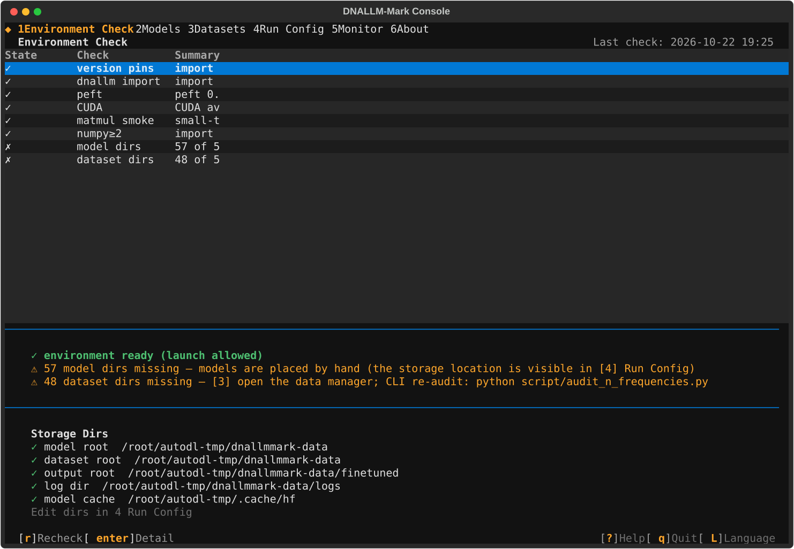

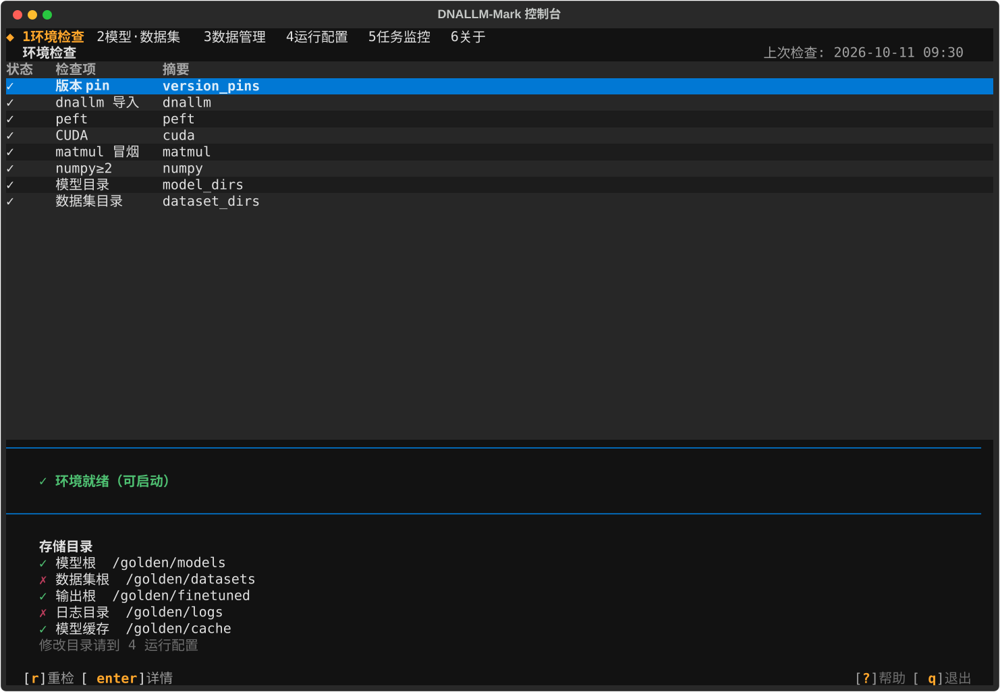

### 第 2 步 — 模型选型与下载（slot 2）

One table: 标记 (`space`) · 过滤 (`/`, the registry grammar `species:` / `type:` / `size:` with a live `(pool N/total)` readout) · 池切换 (`t` — 已适配+自定义 by default, 全部官方 reveals 未适配 rows) · 预设 (`p`, apply replaces the mark sets) · 存预设 (`s`) · 模板 (`x`) · 自定义模型向导 (`w`) · 停用/恢复自定义 (`e`) · 在场矩阵 (`v`, the read-only 59×50 density view). `d` downloads the cursor's missing **adapted** model through the shared queue's dnallm channel: the 下载 cell flips through the live queue vocabulary (◌ 待下载 / ⠋ 下载中 with the parsed percent and transfer rate / ✗ 失败) and lands on ✓ 已下载; a missing unadapted/custom row toasts the manual-placement state naming the landing directory. Full guard chain: [Screen 2](#screen-2--models-模型).

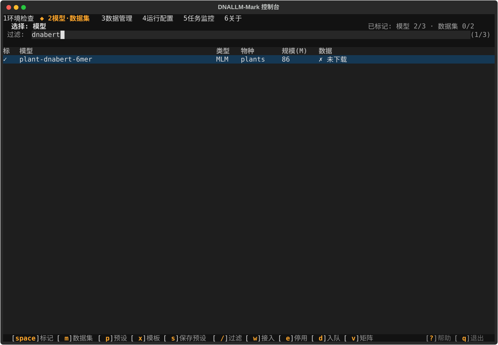

### 第 3 步 — 数据集与数据管理（slot 3）

The dominant top pane is the full official dataset list (在场 summary in the title bar); the bottom pane is the persistent serial queue (状态 / 进度 / 行数对账 columns). `d` enqueues the cursor's missing dataset through the per-dataset ModelScope channel, `a` enqueues **every** missing downloadable dataset at once; presence flips to ✓ exactly when a download lands and reconciles (declared vs measured row counts agree — the golden shows `在场 47/50 · 缺失 3`). `v` toggles the missing-only view derived from the committed n_audit baseline; `r` re-queues the cursor's failed row, `g` (hidden) re-runs the audit on a mismatch row, `z` (hidden) offers the Zenodo whole-package 备选 channel. The queue persists to XDG state and resumes at the next boot. Full key-target contract: [Screen 3](#screen-3--datasets-数据集).

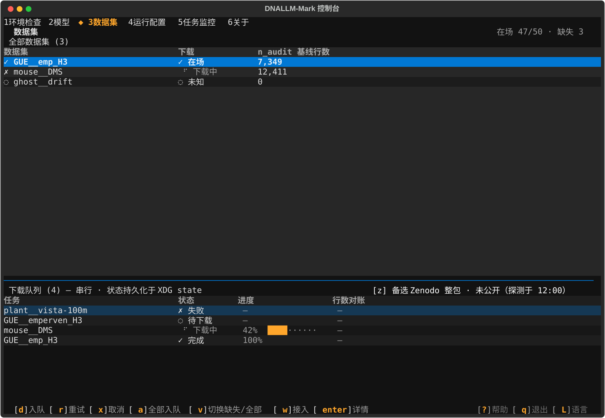

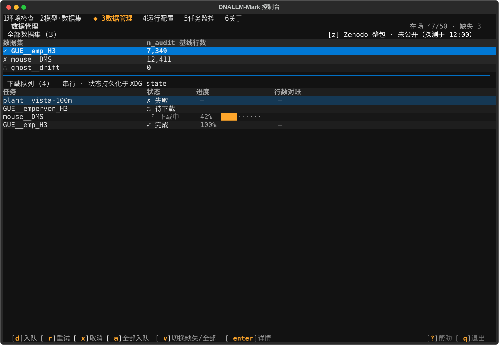

### 第 4 步 — 运行配置与启动门（slot 4）

The real journey frames 02→06, in order:

1. **选择模型**（frame 02）— the slot-4 picker owns its marks (slot-2 state is never read here); the journey marked `plant-dnabert-6mer` and `plant-dnamamba-6mer` (title counts `Models (2/62)`; `/` filters, `space` marks, `m` flips to datasets).
2. **选择数据集**（frame 03）— `m` flips the picker (`Datasets (2/50) · [m] Models`); the journey marked `GUE__emp_H3` and `iDNA_ABF_datasets__5mC`.
3. **基础参数**（frame 04）— seeds edited to `42`, epochs override to `1`, and the 多 GPU 调度 pair `workers 2` / `GPUs 0,1` (an empty GPUs field would thread no `--gpus` and bind GPUs `0..workers-1` at launch). Every keystroke re-derives the dry-run preview line.
4. **高级参数（Phase 19）**— `[a] 展开高级` expands the collapsed 18-param section (the current golden shows the collapsed face: the 高级参数 title, the fixed hints `空 = YAML 默认；变体配置默认不同` and `设置 effective_batch_size 时 GA 仍由其重算`, and the `[a]` keycap in the bottom bar). Empty inputs and the `默认（…）` pseudo-option thread nothing — the YAML governs; `[r] 恢复高级默认` bulk-restores that absent state. Full table: [高级参数（Phase 19）](#高级参数phase-19).
5. **`p` 干跑预览**（frame 05）— the modal shows the same-source counts (`Dry run: 2 models × 2 tasks × 1 seeds = 4 cells`), the same-source note (`Same source: pipeline.run_sweep.enumerate_matrix`), and the **verbatim composed dispatch argv** — the exact list that will spawn, wrapping pre-boxed so nothing clips.
6. **`enter` → Y/N 启动门**（frame 06）— the confirm face stacks the counts formula (`2 models × 2 tasks × 1 seeds = 4 cells → {output root}`), the dispatch-plan line (`Dispatch plan: 2 workers × GPUs 0,1 · 4 cells queued (preview)`), and the planned 模型 × 数据集 pairs derived fresh (here all four, verbatim). **`y` is the only key that launches**; `n`/`esc` cancel, and `enter` is deliberately inert (EHC-2). A full-registry ≥3-seed spec escalates to the E2' typed-phrase modal instead — [the trust boundary](#the-launch-confirmation-and-the-e2-trust-boundary). After `y` the console toasts the cell count and auto-switches to slot 5 with the new sweep attached.

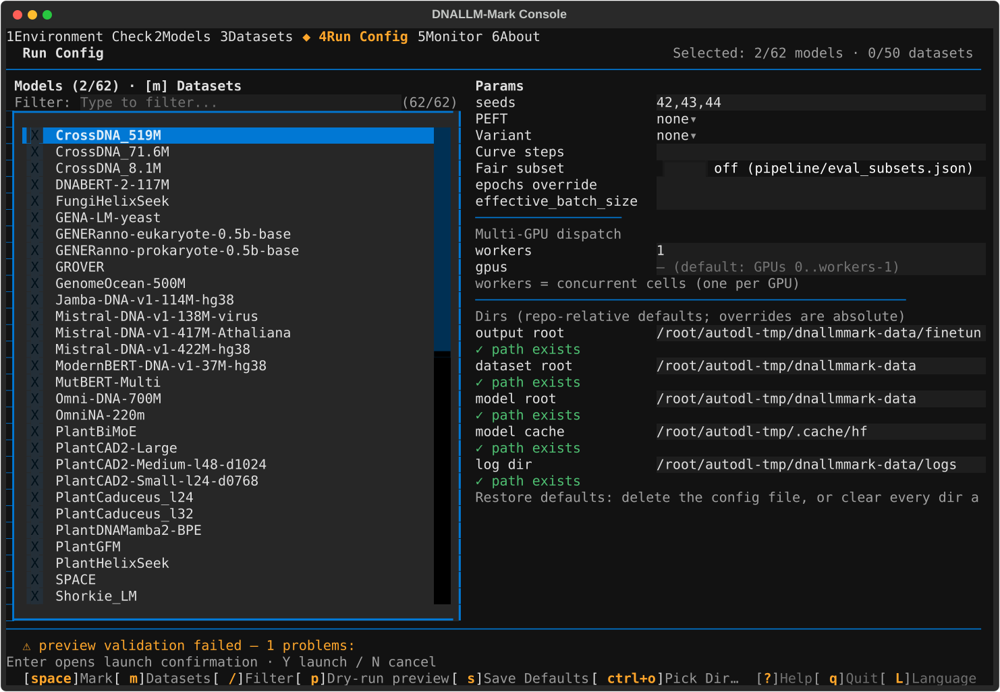


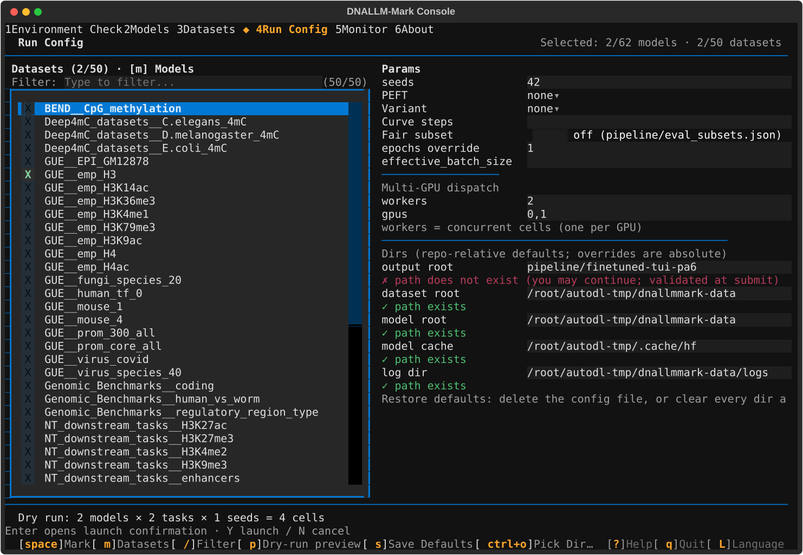

![金面快照：运行配置屏当前形态 —— 收起的高级参数区（两条固定提示）与 [a] 展开高级 键位](../tests/tui/__snapshots__/run_config.svg)

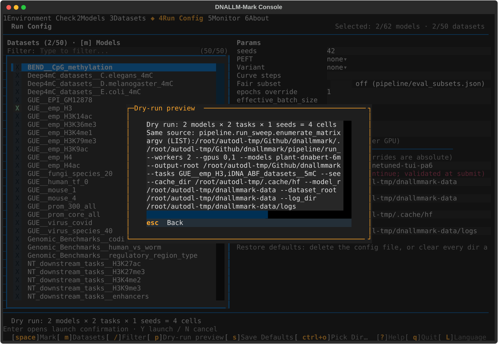

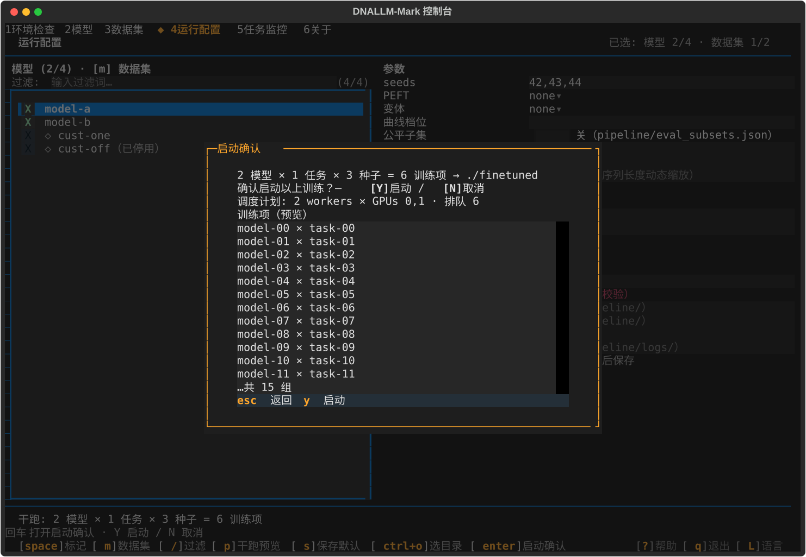

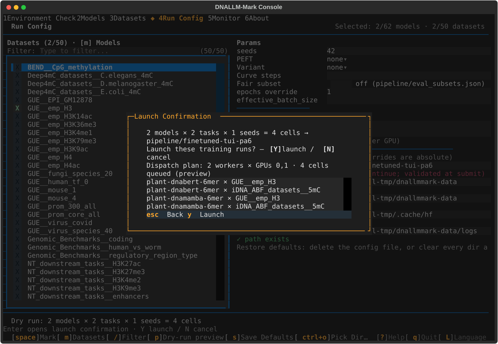

### 第 5 步 — 监视（slot 5）

Frame 07-01 (about 5 minutes in): the Running card `finetuned-tui-pa6` carries the glyph tally (`✓1 ⏵2 ◌0`), progress `1/4`, and `elapsed 4m ETA ≈7m`; the dispatch line reads `dispatch running · 1/4 done · queue 1` with one row per worker (`worker 0 · GPU 0 · ⏵ plant-dnabert-6mer × GUE__emp_H3 × seed_42`, `worker 1 · GPU 1 · ⏵ plant-dnamamba-6mer × GUE__emp_H3 × seed_42`); the entries table folds each 模型×任务 pair into one completion state with the running seed's newest-checkpoint progress (`step 598/2993 20%` + the bar + `ETA ≈10m 3.8 it/s` — the trainer's own it/s). `t` streams the sweep's tee log verbatim (the modal shows the tee path and the `[Dispatch] status=running queue=4 …` lines); the standing G GPU-lanes panel renders `GPU 0 30% 2354/32607 MiB 40°C` / `GPU 1 18% 3584/32607 MiB 39°C` — byte-agreeing with the independent nvidia-smi snapshots in RECORD.md. Keys: `enter` detail/attach, `tab` Running/History, `f` failures, `t` log tail, `a` attach a manual root, `r` immediate rescan, `k` kill (TUI-spawned sweeps only).

The `a` attach path earned its keep on this run: the fresh root is a sibling of the default scan roots and a dispatch root holds no manifest until its first cell finalizes, so nothing was discovered within the first 60 s — typing the resolved absolute path into the `a` modal attached it and the card stayed from the next scan on (RECORD.md, Honest notes).

Frame 99 (55 minutes in): `3/4`, queue drained to the last cell — `worker 0 · GPU 0 · ◌ idle` while worker 1 finishes `plant-dnamamba-6mer × GUE__emp_H3`, the 3076 s long runner of the run. The driver's completion poll fired at 12:21:11Z; the orchestrator's final `dispatch_state.json` (`status=done`, 4/4) landed ~80 s later, and the verification re-run against the quiesced tree counts 4/4/4 (`final_metrics.json` / `flops_report.json` / `trainer_state.json`). Full monitor key map: [Screen 5](#screen-5--monitor-任务监控).

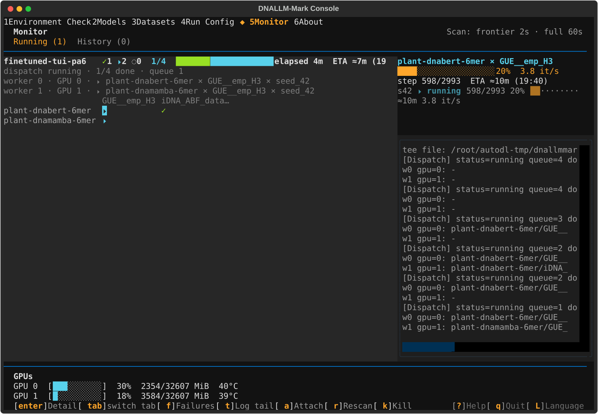

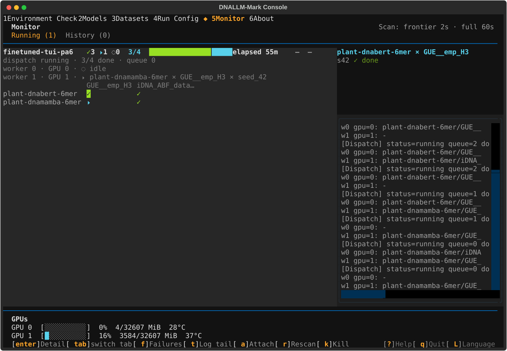

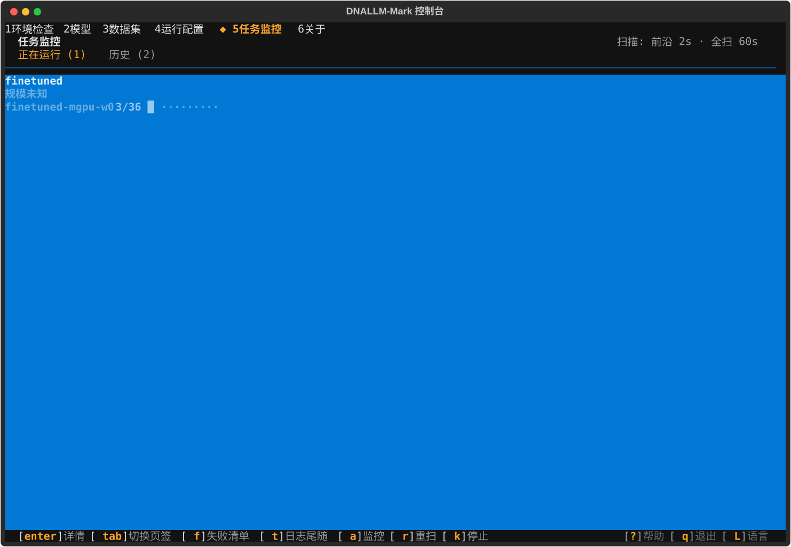

## The shell: top bar, bottom bar, global keys

The shell is two one-row bars around every screen (`tui/screens/nav.py`):

- **Top bar** — six digit-prefixed menu slots. The active screen's slot carries the `◆` diamond prefix plus bold/accent styling. Slot names (UI copy is Chinese; keys are the slot digits):

| Digit | Slot | Screen file |
|-------|------|-------------|
| `1` | 环境检查 (environment check) | `tui/screens/env_check.py` |
| `2` | 模型 (models) | `tui/screens/selection.py` |
| `3` | 数据集 (datasets) | `tui/screens/data_manager.py` |
| `4` | 运行配置 (run config) | `tui/screens/run_config.py` |
| `5` | 任务监控 (monitor) | `tui/screens/monitor.py` |
| `6` | 关于 (about) | `tui/screens/about.py` |

- **Bottom bar** — the active screen's keycaps on the left (declaration order, clipped with a trailing ellipsis on narrow terminals) and the constant help/quit pair on the right.

Global keys (declared app-level in `tui/app.py`, active on every screen):

| Key | Action |
|-----|--------|
| `q` | Quit. With a live sweep (one the TUI spawned, or a CLI-launched sweep attached in the monitor that is running), `q` opens the exit modal instead — see below. |
| `?` | Help modal: every active binding with its label (app bindings first, then the active screen's). `esc` closes. |
| `L` | Toggle the UI language zh ↔ en, live (no restart): every mounted screen re-renders, the bars/footer/help labels follow, and the choice persists to `language.json` under the XDG state root (`DNALLMMARK_TUI_STATE_DIR` redirectable) so the next `make tui` boots in it. The **default is English**; a missing or corrupt file falls back to English. A focused input consumes the keystroke as text — unfocus first. |
| `1`–`6` | Switch to the slot's screen (declared per screen as hidden bindings routed to the app's `nav` action). Pressing the active slot's digit is a no-op. |

**Exit modal** (pushed by `q` when a live sweep exists, `tui/app.py` `ExitModal`):

| Key | Action |
|-----|--------|
| `enter` | Detach and quit (default) — drop the handle; the sweep survives and stays resume-safe via the per-cell `trainer_state.json` marker. |
| `k` | Kill — SIGTERM the sweep's process group, then quit. |
| `esc` | Return to the console without quitting. |

While any modal is open, screen/app keys do not fire (`esc` is the universal close). A focused input (filter, seeds, paths) consumes its own keystrokes — including digits — until focus leaves it; this is by design so typing can never trigger navigation or launch.

## Screen 1 — Environment check (环境检查)

Runs the eight `pipeline/env_smoke.py` kernels and shows the verdict that the slot-4 launch confirmation enforces. Results persist for the local calendar day: a same-day restart renders the cached result instantly and runs zero kernels.

The eight rows, in kernel order: `version_pins`, `dnallm`, `peft`, `cuda`, `matmul`, `numpy`, `model_dirs`, `dataset_dirs`.

| Key | Action |
|-----|--------|
| `r` | Re-run every kernel (the only path that re-runs after a cache hit). Rows reset to pending, the exclusive worker restarts. |
| `enter` | Open the cursor row's drill-down modal: the kernel's own detail lines, verbatim, wrapping and scrolling — never elided. `esc` closes. |

Verdict block (rendered from `tui/services/env_gate.py`):

- A failure in any **critical** kernel — `version_pins`, `dnallm`, `peft`, `cuda`, `matmul`, `numpy` — renders "✗ 关键项未通过" naming the kernels, and the slot-4 launch confirmation blocks the launch (env preflight re-runs the same critical set at gate time).
- A `dataset_dirs` failure does not block launch by itself; it renders the routing hint "⚠ {n} 个数据集目录缺失 — [3] 前往数据管理" with the CLI re-audit command (`python script/audit_n_frequencies.py`).

## Screen 2 — Models (模型)

The operator's daily model surface: ONE table of models with the mark column, the 适配 column (the committed dnallm-adaptation verdict), and the 下载 column (the live per-model disk presence). Dataset marks still arrive through presets/templates and display in the matrix and the status line — the interactive dataset table lives on slot 3.

Marks live in shared app-state sets (not inside the table), so filter rebuilds and the pool toggle never lose them.

| Key | Action |
|-----|--------|
| `space` | Toggle the mark on the cursor row. Marking a **disabled custom** entry is refused with a warning (a mark the sweep can never see). State rows (loading / no-match / error) never mark. |
| `t` | Toggle the model pool: the default lists **dnallm-adapted official models plus customs** (customs are always visible — operator-added, outside the official registry the adaptation verdict constrains); `t` reveals ALL official entries with unadapted rows clearly marked 未适配 — never hidden data. The filter-count readout carries the active pool (已适配 / 全部); the text filter composes AND over the active pool. |
| `/` | Focus the filter input — k9s-style type-to-filter over the registry grammar; live `(pool N/total)` readout; unknown-axis terms render a dim warning while valid terms still apply. |
| `esc` | Clear the filter and refocus the table (when the filter is not active, `esc` is a no-op here). |
| `enter` | Open the cursor row's card drill-down (every registry field, wrapping, never elided). |
| `p` | Open the preset picker: derived tier-1 / tier-2 / all presets plus your saved customs (sorted). Highlight a preset and press `enter` (or toggle it) — the first selection **applies and closes**. Applying **replaces** the mark set(s); keys not in the current registry are skipped with a loud warning, never silently. |
| `s` | Save the current marks as a named custom preset (path/name modal; an existing name asks a confirm before overwrite). Presets persist to `presets.json` under the XDG config root. |
| `x` | Template menu (import / export / tier-convert). Import validates collect-all and fail-closed — a bad file renders the numbered problem list and applies nothing; export writes the selection as a run template JSON; tier-convert exports it as a `sweep_priorities.json`-style tier list. |
| `w` | Open the MODEL onboarding wizard (the kind is constant on this screen). With the cursor on a custom row, the form prefills from that entry (edit = re-record). Wizard keys: `enter` advance, `b` back, `f` import (step 1), `o` export registry (step 1), `u` undo a just-landed entry, `esc` cancel. |
| `e` | Toggle the cursor **custom model** entry's enabled state (disable removes it from runs at loader level; the row stays visible with the disabled suffix). On an official row it is a no-op with an honest toast. |
| `d` | Download the cursor's model through the shared queue's **dnallm channel** (`dnallm.models.model.download_model` + a ModelScope snapshot downloader; the landing dir is the effective model root joined with the registry `Model_path`, normalized so `config.json` sits directly in the model dir). Guard chain: an already-downloaded row gets the honest already-downloaded toast; a missing **adapted** row enqueues (outcome toasts for already-queued / channel-unavailable / CLI-unavailable / persist-failed); a missing **unadapted or custom** row toasts the manual-placement state **naming the landing directory** — manual weight placement, never huggingface guidance; a ◌ 未知 row (no `Model_path`) stays silent. A finished download flips the row's 下载 cell to ✓ 已下载 live. |
| `v` | Push the read-only 59×50 presence matrix (marks shown as `◆` prefixes). `enter` shows a cell's full keys; `esc` returns. |

The 下载 column vocabulary: ✓ 已下载 (present) · ✗ 未下载 (missing + adapted — the `d`-able state) · 手动放置 (missing unadapted-or-custom — the honest private/no-source state) · ◌ 未知 (no `Model_path` or drift). The 适配 column: 已适配 · 未适配 (dim) · 自定义.

Since the 2026-10-15 revision, the 下载 column is also the **live model-download surface**: a row whose key carries a live queue entry (pending / downloading / failed) renders the queue's own state word (◌ 待下载 / ⠋ 下载中 / ✗ 失败) in place of the static vocabulary, the driver's progress ticks update the cell in place (a parsed integer percent composes beside the 下载中 word, and — EHC-4, later the same day — a parsed transfer rate, e.g. `892kB/s`, appends after it; nothing parsed keeps the ⠋ indeterminate — never a fabricated number, never a fabricated speed), and a finished download flips to ✓ 已下载 as before. The column is 28 cells wide to fit the widest honest composition without clipping (narrow terminals h-scroll). Model downloads no longer appear on slot 3's queue table — the shared queue itself is unchanged, only the presentation splits by kind.

## Screen 3 — Datasets (数据集)

Two stacked panes over one shared, persistent download queue: the **full official dataset list** (top, the primary pane — every registry key with a 下载 cell and the n_audit baseline row count) and the **queue table** (bottom; rows in five states — pending / downloading / done / failed / mismatch — with live percent + progress bar and a reconcile column; when the CLI emits a transfer rate, EHC-4 appends it as a dim data word beside the progress — no rate parses, percent-only, never a fabricated speed). The missing-only list is the `v`-toggled alternate. Mismatch and failed rows sort to the top and each number-carrying mismatch gets a banner. The title bar shows the presence summary (present/total/missing); a right-aligned line in the **queue** title row probes the Zenodo whole-package record (19135551) — the 备选 alternate channel, never the default (per-dataset ModelScope downloads are the default channel).

Since the 2026-10-15 revision the top pane is the **dominant** pane — roughly two thirds of the screen (scrollable; 9+ dataset rows visible even at the 80x24 minimum grid, 12+ at 120x40) — and the queue table lists **dataset entries only**: model downloads surface on slot 2, never here (the shared queue mechanism is unchanged; the presentation splits by kind).

A row with a **live queue entry** renders the queue's own state word (待下载 / 下载中 / 失败 / 对账不一致) in its 下载 cell; a done entry reads ✓ 在场 through the merged presence instead.

Key-target contract (`d`/`r`/`x` act on their own table's cursor regardless of focus; only `enter` routes by focus):

| Key | Target | Action |
|-----|--------|--------|
| `d` | full list (or the v-toggled missing list) | Enqueue the cursor's dataset through the per-dataset **ModelScope channel** (the default since the 2026-10-14 ruling). A present row gets the honest already-present toast. Idempotent; outcome toasts for already-queued / disabled-channel / unknown-key / CLI-unavailable / persist-failed. |
| `a` | — | Enqueue **every** missing downloadable dataset (count toast). |
| `r` | queue table | Re-queue the cursor's failed/mismatch entry. Other states get a no-op toast. |
| `x` | queue table | Cancel the cursor's pending/downloading entry — always behind a confirm modal (`enter` confirms, `esc` cancels). |
| `v` | top pane | Toggle between the full list and the missing-only list. |
| `w` | — | Open the DATASET custom-entry wizard (the kind is constant here). The land-completion callback reloads the pane. |
| `enter` | focused table | Drill-down modal: full key, registry `download_url` (the only download authority), the composed download argv, state/attempts/percent, reconcile numbers, and the verbatim CLI/audit log lines — data, never elided. |
| `g` | queue table | (Hidden) Re-run the n_audit audit for the cursor's **mismatch** row — live only on mismatch rows; refreshes both panes when done. |
| `z` | — | (Hidden) Enqueue the Zenodo whole-package bundle (the 备选 alternate) — offered only when the publication probe answered "public"; otherwise an explanatory toast. |

The queue is serial, persisted to XDG state, and resumed automatically on the next `make tui` if pending work exists (model downloads ride the SAME shared queue — `kind=model` entries persist and resume the same way, with no reconcile leg: a model download is done when its normalized landing dir holds `config.json` directly — but they render on slot 2, never in this screen's queue table). A done dataset download that reconciles (declared vs measured row counts) is the moment presence flips to ✓ everywhere (the full list, the counts). A landed-but-mismatched dataset never flips; use `g` after fixing.

## Screen 4 — Run config (运行配置)

The composition surface: its own model/dataset pickers (slot 2's marks are never read here — this screen owns a persistent run spec), the params pane, directory fields, a live dry-run preview line, the launch-confirmation entry hint, and the launch confirmation.

| Key | Action |
|-----|--------|
| `space` | Toggle the mark on the picker's cursor row. Marks live in the run spec itself and persist to XDG state; disabled customs warn instead of marking. |
| `m` | Flip the picker between models and datasets. |
| `/` | Focus the picker filter (same grammar as slot 2). `esc` clears it. |
| `enter` | **Open the launch confirmation** (see the next section). On the picker itself, `enter` is pinned to the confirmation — only `space` marks. On a focused choice row (PEFT / variant), `enter` opens that row's radio-set modal instead; a focused text input consumes its own `enter` (re-applies the field) — typing can never launch. |
| `p` | Dry-run preview modal: the same-source enumeration counts, the note that the gate re-derives everything fresh, the exact composed `run_sweep_shard.py --mode dispatch` argv (verbatim, when the spec is clean), and the numbered problem list otherwise. |

Params pane fields (edits persist and re-derive the preview line on every change):

| Field | Form | Notes |
|-------|------|-------|
| seeds | text input | Comma-separated; default `42,43,44`. Three-plus seeds over the full official matrix is what triggers the E2' gate. |
| PEFT | choice row (`enter`) | `none` / `lora` / `ia3`; a hint shows the adapter alias for the first marked model. Cannot be combined with a config variant. |
| variant | choice row (`enter`) | `none` / `head` / `probe` / `curve`. `probe` surfaces the frozen probe-ineligible model list if any marked model is affected; `head` shows its own note. |
| 曲线档位 (curve) | text input | Comma-separated train fractions (`--curve`). |
| 公平子集 (fairness subset) | checkbox | Off by default; when on, the path row appears (default `pipeline/eval_subsets.json`) with an exists/missing advisory. |
| epochs / effective_batch_size | text inputs | Optional overrides (`--num_train_epochs`, `--effective_batch_size`). |
| 多 GPU 调度 (workers / `GPUs`) | text inputs | The dispatch pair (Phase 16): `workers` carries a live default `1`; an empty `GPUs` field threads no `--gpus` and the dispatcher binds GPUs `0..workers-1` at launch. Every slot-4 launch composes `run_sweep_shard.py --mode dispatch` (see [Multi-GPU launch and monitoring](#multi-gpu-launch-and-monitoring)). |
| output root / dataset root / cache | text inputs | Defaults `./finetuned` and `./datasets`; each carries an exists/missing advisory (missing roots are advisory only — the sweep creates them). |

After a successful launch the console toasts the cell count and auto-switches to the monitor (slot 5) with the new sweep attached.

## 高级参数（Phase 19）

Slot 4's params pane carries a titled 高级参数 block, **collapsed by default**. `[a] 展开高级` flips it open (view-only — typed values keep threading while collapsed), `[r] 恢复高级默认` bulk-restores the absent state, and per-field restore is simply clearing the input or re-picking the 默认 pseudo-option. Values persist with the run spec and re-prefill on the next mount.

The 18 rows render in the frozen table's order (alphabetical = argv block order). Every row's placeholder states the **base** `finetune_config.yaml` literal as `—（默认: …）` display copy — never a default value: an empty input / the 默认 pseudo-option means the flag is **absent** (zero argv elements, zero manifest keys) and the loaded YAML governs; variant YAMLs (`head` / `probe` / `curve`) carry different defaults, which is exactly what the fixed hint `空 = YAML 默认；变体配置默认不同` says.

The truth table — `ADVANCED_TRAIN_FLAGS` in `pipeline/run_sweep.py` — is the ONE shared vocabulary: this module's argparse family and guards, the dispatch orchestrator's mirrors, and the slot-4 service (`tui/services/run_config.py`, same import) all consume it; the child `run_finetune.py` keeps its own local registration tuple (standalone by design), pinned against drift by a contracts parity test. Rows verbatim:

| 参数 (flag) | 类型 | 界限 / 取值 | 基础 YAML 默认 |
|---|---|---|---|
| `--adam_beta1` | float | [0.0, 1.0] | `0.9` |
| `--adam_beta2` | float | [0.0, 1.0] | `0.999` |
| `--adam_epsilon` | float | [0.0, 1.0] | `1e-8` |
| `--bf16` | bool | `true` / `false` | `True` |
| `--eval_steps` | int | ≥ 1 | `500` |
| `--eval_strategy` | enum | `no` / `steps` / `epoch` | `steps` |
| `--gradient_accumulation_steps` | int | ≥ 1 | `1` |
| `--learning_rate` | float | [1e-9, 1.0] | `2e-5` |
| `--logging_steps` | int | ≥ 1 | `500` |
| `--logging_strategy` | enum | `no` / `steps` / `epoch` | `steps` |
| `--lr_scheduler_kwargs` | json | must be a JSON **object** | `{}` |
| `--lr_scheduler_type` | enum | 12 值: `linear` · `cosine` · `cosine_with_restarts` · `polynomial` · `constant` · `constant_with_warmup` · `inverse_sqrt` · `reduce_lr_on_plateau` · `cosine_with_min_lr` · `cosine_warmup_with_min_lr` · `warmup_stable_decay` · `greedy` | `linear` |
| `--max_grad_norm` | float | ≥ 0.0 | `1.0` |
| `--save_steps` | int | ≥ 1 | `500` |
| `--save_strategy` | enum | `no` / `steps` / `epoch` | `steps` |
| `--save_total_limit` | int | ≥ 1 | `2` |
| `--warmup_ratio` | float | [0.0, 1.0] | `0.1` |
| `--weight_decay` | float | [0.0, 1.0] | `0.01` |

Reading notes:

- **Bounds are inclusive sanity mirrors**, not optimizer constraints: `learning_rate`'s `[1e-9, 1.0]` documents "values below 1e-9 are typos"; ints are ≥ 1 (the `--batch_size` guard shape); the json row must parse to a dict (`TrainingArguments` requires an object — `json.loads` arrays/scalars are refused with a named problem).
- **Enum/bool rows are ChoiceRows**: `enter` opens the RadioSet dropdown listing the closed vocabulary verbatim, led by the `默认（{value}）` pseudo-option (its display carries the base YAML default; picking it maps back to absent). The vocabularies are the live-probed transformers 5.17.0 sets (12 `SchedulerType`, 3 `IntervalStrategy`) — never training-data memory.
- **与 EBS / batch 的关系**: the second fixed hint — `设置 effective_batch_size 时 GA 仍由其重算` — the typed `gradient_accumulation_steps` threads through, but a present `effective_batch_size` still owns the GA arithmetic in the child. `batch_size` (its own row above the section, placeholder `—（默认: 按序列长度动态缩放）`) is the per-device **starting** micro-batch base: the child's `determine_batch_size` caps it by sequence-length tier — ≤128→32 · ≤256→16 · ≤640→8 · ≤1280→4 · ≤2560→2 · >2560→1 (`max(1, min(base, cap))`) — and when `max_length > 2560` the cap ladder has bottomed at batch 1, so gradient checkpointing is enabled **automatically** (numerically equivalent; trades ~30% step time for memory on the MoE/KDA-class long-sequence cells whose activation budget exceeds a 32 GB card even at batch 1).
- **Manifest**: the family rides ONE nested `"advanced"` dict key in `sweep_flags`, written only when non-empty — an absent family contributes zero keys (the whole-family-absent parity).

## The launch confirmation and the E2' trust boundary

`enter` on slot 4 opens a terraform-style confirmation pipeline — a persistent dim hint line below the preview line (`回车 打开启动确认 · Y 启动 / N 取消`) names the entry key and the confirm keys so the flow is discoverable without the docs. Every stage recomputes through the services — the preview line's cache is never trusted:

1. **Fresh enumeration** — invalid specs (empty selection, bad seeds/curve, probe-ineligible models, PEFT×variant composition, invalid output root) open the numbered problems modal and nothing launches. A launch into an output root that already has a **live** sweep is also refused here, naming the root.
2. **Env preflight** — the critical kernel set re-runs; failure opens the env-block modal naming the failing kernels and their verbatim reasons (route to slot 1, press `r` after fixing).
3. **Confirm** — a summary modal: the counts formula (models × tasks × seeds → cells, output root) with the actual **task plan listed under it** — one `模型 × 数据集` pair per line, derived fresh from the same enumeration (never the screen's cache); long plans cap at the first 12 pairs plus a `…共 N 组` total line. **`y` launches, `n`/`esc` cancel** — `enter` is deliberately inert on launch confirms (EHC-2, 2026-10-15: a stray double-enter can never start GPU work; the `n` cancel joined with UX-6, 2026-10-16).
4. **E2' escalation (when applicable)** — if the spec is the **full official re-run** (models superset of the official registry, tasks superset of the official trainable tasks, and **≥ 3 seeds** — `E2X_MIN_SEEDS = 3`, `tui/services/run_config.py`), the plain confirm is replaced by the typed-phrase modal.

The typed-phrase modal ("⚠ 全量 E2' 训练任务 — 59 模型 × 50 数据集 × 3 种子 = 8850 训练项") demands the operator type the **final directory name of the resolved absolute output root** (e.g. an output root `./finetuned` demands the phrase `finetuned` — the modal itself shows the exact expected name). The verdict is exact string equality — no stripping, no case folding — evaluated by the service tier on every keystroke (the widget holds no matching logic). **The confirm is a two-step (EHC-2, 2026-10-15): type the phrase, press `enter` to advance to the y-ready state (the input blurs, the indicator shows the [Y] 启动 / [N] 取消 wording — `enter` never launches), then press `y` to launch or `n` to cancel.** The phrase stays double insurance on top of the y-confirm. The check fails closed on a degenerate empty phrase, and the launcher service re-proves the phrase structurally before spawning — no widget path can normalize its way past it. This is the maintainer authorization boundary for full E2' runs.

The same gate, including the E2' phrase, applies to the monitor's from-failures re-run (below): an E2'-class effective matrix refuses at the phrase stage and re-prompts.

**Multi-GPU capacity gate (EHC-3, 2026-10-15; semantics amended by Phase 16).** Both gated launch paths — the slot-4 gate and the monitor's re-run — refuse when the live-sweep registry's GPU demand (each live entry's `--workers` when it runs the shard orchestrator, else 1) plus the requested workers exceeds the machine's *effective* GPU count (`WORLD_SIZE` when set, else `torch.cuda.device_count()` honoring `CUDA_VISIBLE_DEVICES`). The refusal names the live roots, the requested workers, and the GPU count: wait, kill via the exit modal, or lower workers. It fires at stage 0 (before any preview, env preflight, or confirm) and is enforced in the launcher service itself — the spawn never happens. Count-0 machines (no torch/CUDA) are unrestricted.

The CLI has no such gate, by design — `run_sweep.py` / `run_sweep_shard.py` are the maintainer trust surface (see "The E2' trust boundary" in `docs/multi-gpu.md`).

## Screen 5 — Monitor (任务监控)

Monitoring over the artifact scanner. Cadence (shown right of the title): a 2-second frontier pass over the **attached** root and a 60-second full scan; `[r]` forces a full rescan immediately. The layout is a **discovered sweeps** table (top) and the **entries table** (bottom — one row per model × dataset entry of the attached sweep), plus a one-row stats line (done/total, current model×task×seed, elapsed, ETA point/range/pending).

Discovered rows carry three states — running / finished / artifacts-only (a root with artifacts but no live process and no completion) — with a `{done}/{total}` progress bar and ETA on running rows, and the manifest scale (`models×tasks×seeds`) when the terminal is wide.

The **entries table** (columns 模型 / 任务 / 状态 / 进度) folds each entry's seeds into one completion state — ⠋ 运行 when any seed runs, ✗ 失败 when any failed, ✓ 完成 when all finished (⊘ resume-skipped counts as finished), ◌ 排队 otherwise — with the done/total seed count beside the word (e.g. `⠋ 运行 1/3`). The 进度 cell reads the running seed's **newest checkpoint** (`checkpoint-*/trainer_state.json`, numerically-largest suffix) on the 2s cadence: `steps/max percent%` plus a 10-cell bar while training progresses. Honest degradation throughout — a running cell with no parseable checkpoint yet renders `⠋ …` (never a fabricated number), non-running entries render the dim dash. Per-seed states, curve-fraction lines, and each seed's `run_record` fields stay in the `enter` drill-down. A resume-count note sits on the entries title row.

Two standing multi-GPU surfaces render live dispatch state (Phase 16): the G GPU-lanes panel below the tab content — one lane per GPU (utilization bar+%, memory used-total, temperature; `◌ nvidia-smi 未安装` when the probe cannot run), on both tabs with no key of its own — and, on running cards whose root carries `dispatch_state.json`, the dispatch rows (dispatch line + one row per worker, stale-marked past the 3600 s cell-scale grace). See [Multi-GPU launch and monitoring](#multi-gpu-launch-and-monitoring).

| Key | Action |
|-----|--------|
| `enter` | On the discovered table: **attach** the cursor's sweep root (the `◆` marker moves; the entries table, stats, failures, and log keys rebind to it; a toast confirms). On the entries table: open the entry-detail modal — per-seed states, per-fraction lines, and each seed's `run_record` fields verbatim. |
| `f` | Failures modal over the attached root (live failure records / `sweep_failures.json`): one row per failure; `enter` drills the verbatim error string. |
| `r` *(inside the failures modal)* | Re-run the failures — behind its own **launch confirm** (real GPU spend: `y` starts, `n`/`esc` cancel, `enter` is inert — EHC-2), then the **same gate as slot 4**: env preflight first, the E2' phrase (type, `enter` to advance, `y` to launch) if the effective matrix demands it, then a `--from-failures` launch at the sweep's own root carrying the source sweep's own lane (`--peft` / `--config-variant` recovered from its artifacts). |
| `t` | Log-tail modal: the attached sweep's tee file, refreshed on the 2s cadence while open; the dim line names the file. A CLI-launched sweep (no tee) renders the designed unavailable state and schedules no refresh. |
| `a` | Attach a **manual root**: path modal, validated as a real sweep root; invalid paths keep the modal open with the reason. Manual roots persist across sessions. |
| `r` *(screen level)* | Immediate full rescan; the count toast lands when the scan does. |

After a TUI launch, the new sweep is auto-attached and the console switches here automatically.

## Screen 6 — About (关于)

Read-only. Five rows — software (version + git sha), data (official/custom counts + n_audit presence), milestone, dependencies, repository — derived in a background worker, tolerant of any missing probe. No action keys beyond the nav digits and the global `?` / `q`.

## Multi-GPU launch and monitoring

Two paths into multi-GPU, both first-class since Phase 16:

- **Launch from the TUI (slot 4).** The params pane's 多 GPU 调度 section (`workers` / `GPUs` fields, see the Screen 4 table) composes `run_sweep_shard.py --mode dispatch --workers N` — every slot-4 launch is a dispatch launch. The confirm face previews the dispatch plan (workers × GPUs × queued cells) on its one dispatch-plan line, and the capacity stage refuses when the live registry's GPU demand plus the requested workers exceeds the machine's GPU count.
- **CLI-launched runs stay attachable.** A dispatch run carries ONE shared root — `dispatch_state.json` inside the output root is the mode evidence. Attach it (`a`, or `enter` on the discovered row) like any sweep root and slot 5 renders it natively: the Running card's dispatch line (status · done/total · queue depth) plus one row per worker (the in-flight cell, or ◌ idle) read from `dispatch_state.json` v2 on the 2s cadence, stale-marked when the state file's age crosses the cell-scale grace (3600 s, `DISPATCH_STALE_SECONDS`). Below the tab content on BOTH tabs stands the G GPU-lanes panel — one lane per GPU (utilization bar+%, memory used-total, temperature, `◌ nvidia-smi 未安装` when the probe cannot run); it has no key, it is standing chrome. For the walkthrough of these surfaces (and its queued-GIF note): [TUI-DEMO section 11](TUI-DEMO.md#11-multi-gpu-dispatch-launch-and-monitoring).

The **static-mode variant** (CLI `--mode static`, see `docs/multi-gpu.md`) spawns per-worker roots instead — `{output-root}-mgpu-w{i}`, one independent output root per worker. Those are monitored by attaching each root:

1. `make tui`, go to slot 5.
2. Press `a` once per worker root — e.g. `pipeline/finetuned-mgpu-w0`, `pipeline/finetuned-mgpu-w1`. Attachments are validated and **persisted** (they survive restarts).
3. The discovered table lists every worker as its own row with independent progress/ETA; `enter` on a row switches the attached cell-table/stats/failures/log view to that worker.

Roots are discovered from two default scan roots plus your manual roots: `{repo}/pipeline/finetuned` and `{repo}/finetuned` (both resolution homes of the default `./finetuned` — TUI-launched sweeps run with cwd pinned to `pipeline/`, CLI runs resolve against the shell's cwd) plus everything in the persisted manual-roots list.

Two limits to know:

- The TUI exit prompt (`q` → kill) can only kill processes **the TUI spawned**. CLI-launched workers must be stopped with the process-group recipe in `docs/multi-gpu.md` (`kill -TERM -<pgid>`); workers are deliberately Ctrl-C-immune (own session, resume-safe).
- Failed-cell re-runs split by mode: the TUI's `[f]` → `[r]` from-failures re-run operates on the attached sweep root only (healthy workers are never touched), while cross-worker recovery of a dispatch root's failed cells is the CLI's `--rerun-failed` over that one shared root (see `docs/multi-gpu.md`).

## State persistence (what lives where)

All TUI state resolves through `tui/services/settings.py` via platformdirs, with whole-directory env overrides. The state/config split is absolute: regenerable machine state never lands under the config root; hand-authored config never lands under the state root. Every write is atomic (temp sibling + `os.replace`).

**`~/.local/state/dnallmmark`** (XDG state root — regenerable machine state):

| File | Contents |
|------|----------|
| `env_check.json` | Env-check results + checked-at (the same-day cache) |
| `download_queue.json` | The persistent download queue (dataset, zenodo-bundle, and model entries, states, reconcile payloads) — resumed at boot |
| `run_config.json` | The slot-4 run spec (marks, seeds, PEFT, variant, dirs) |
| `monitor_roots.json` | Manually attached monitor roots |
| `zenodo-19135551/…` | Staging for the Zenodo whole-package download |

**`~/.config/dnallmmark`** (XDG config root — user-owned, hand-shareable):

| File | Contents |
|------|----------|
| `presets.json` | Saved custom selection presets (`s` on slot 2) |
| custom model/dataset registries | Landed custom entries from the `w` wizard (same root the pipeline's overlay loader reads) |

Overrides (whole directory; empty value = unset): `DNALLMMARK_TUI_STATE_DIR`, `DNALLMMARK_TUI_CONFIG_DIR`, and `DNALLMMARK_CUSTOM_REGISTRY_DIR` for the custom-registry overlay root.

## Troubleshooting

**The launch confirmation blocked with an env failure (EnvBlockModal).** The critical kernels are `version_pins`, `dnallm`, `peft`, `cuda`, `matmul`, `numpy`. Go to slot 1, `enter` the failing row for the verbatim reason, fix, press `r`, then retry the gate. Common causes: `dnallm` is deliberately not in any committed dependency group — it must be installed manually from a local clone (see `docs/CONFIGURATION.md`); `cuda`/`matmul` require the `gpu` group and a real GPU (`make tui` already includes `--group gpu`).

**Missing datasets (dataset_dirs ✗ / presence ✗).** Slot 1 shows the count and the `[3]` routing hint. On slot 3, `d` enqueues the cursor's missing row or `a` enqueues all; watch the queue pane (states, progress bar, reconcile column). Presence flips to ✓ exactly when a download lands and reconciles. If a download finishes as **mismatch** (declared vs measured rows differ), fix the cause and press `g` on the row to re-audit; **failed** rows are re-queued with `r`. A `cli_unavailable` toast means the ModelScope CLI is not on PATH; a `disabled` toast names the dataset key whose channel is disabled in the registry.

**Keys 1–6 or `enter` "do nothing" while typing.** A focused input consumes its keystrokes. Press `esc` (clears the filter and refocuses the table) or move focus off the input. Related pin: a focused text input also consumes `enter`, so typing parameters can never open the launch confirmation — `enter` opens the confirmation only from the picker or an unfocused surface.

**The terminal went blank with a single Chinese line.** The window is below 80×24 — the min-size guard replaced everything. Enlarge the window; the previous screen (and any open modal beneath the guard) is restored exactly.

**Log tail says unavailable.** The attached sweep was launched from the CLI, so the TUI holds no tee file for it. Follow the worker's own per-launch log (`{root}-mgpu-w{i}-{stamp}.log`, or the launcher's tee under the output root) in another terminal.

**A download stalled with a persist-failure toast.** The queue state file could not be written (permissions/disk). The entry stays pending; fix the state rail (`~/.local/state/dnallmmark/download_queue.json` and its directory) and re-kick by enqueuing anything or restarting the console — pending work resumes at boot.

**Everything looks stale after an external change.** The monitor rescans every 60 seconds (2s for the attached root) — press `r` on slot 5 for an immediate rescan, or `r` on slot 1 to re-run the env check. The data manager reloads both panes whenever you navigate to it (press another slot's digit, then `3` again).

## 组件说明

The console is a strict two-tier build: `tui/screens/` is presentation only (widgets render state held by services and post intent — no verdict, enumeration, or persistence lives in a widget), and `tui/services/` is textual-free (zero Textual imports, enforced) and owns every computation, gate check, and XDG write. One line per component, from each module's own docstring:

**界面屏 (`tui/screens/`)**

| 文件 | 职责 |
|------|------|
| `tui/screens/nav.py` | The navigation shell's chrome: the 1-row top menu bar (six digit-prefixed slots, the active one carrying the `◆` diamond) and the bottom keycap bar every screen renders inside. |
| `tui/screens/env_check.py` | Slot 1 环境检查: the eight-row kernel table in `main()` kernel order plus the verdict block the slot-4 launch gate enforces. |
| `tui/screens/selection.py` | Slot 2 模型: the models table (mark / 适配 / 下载 columns), the filter grammar, presets, templates, the onboarding wizard entry, and the `d` model-download surface. |
| `tui/screens/data_manager.py` | Slot 3 数据集: the full official dataset list over the persistent download queue (five queue states, reconcile column, Zenodo 备选 entry). |
| `tui/screens/run_config.py` | Slot 4 运行配置: own model/dataset pickers, the params pane (base + the Phase-19 advanced block), the dirs section, the live dry-run preview line, and the launch-confirmation pipeline. |
| `tui/screens/monitor.py` | Slot 5 任务监控: the two-tab (Running / History) sweep cards, the entries table, the dispatch + GPU-lanes surfaces, and the failures / log-tail modals. |
| `tui/screens/matrix.py` | The auxiliary read-only density view: one row per model, one column per dataset, marks shown as `◆` prefixes — pushed from slot 2's `v`. |
| `tui/screens/about.py` | Slot 6 关于: five read-only rows (software / data / milestone / dependencies / repository) derived tolerantly in a background worker. |

**服务层 (`tui/services/`)**

| 文件 | 职责 |
|------|------|
| `tui/services/run_config.py` | The pure brain under slot 4 and the launch gate: the run-spec model + collect-all validation, XDG persistence, the same-source dry-run preview (`enumerate_matrix` verbatim), the E2' verdict and typed-phrase check, and argv composition. |
| `tui/services/sweep_launcher.py` | The launch lifecycle service: the injectable Popen execution tier — gate stages (enumeration, env preflight, confirm, capacity), the spawn, kill/detach, and the live-sweep registry the exit modal and monitor read. |
| `tui/services/sweep_monitor.py` | The pure artifact-tree scanner: everything the monitor screen renders about sweeps (discovered roots, per-entry/per-seed states, checkpoint progress, failures) derives from here. |
| `tui/services/download_queue.py` | The download orchestration core: the persistent serial queue with its five-state machine, the dataset and model channels, resume-at-boot, and reconcile payloads. |
| `tui/services/registries.py` | The registry view on the tui → pipeline seam: overlay-merged model/dataset entries plus the disk-presence expansion the tables render. |
| `tui/services/gpu_probe.py` | The read-only nvidia-smi CSV probe — the data half of the monitor's G GPU-lanes panel (fixed literal query argv; honest `◌ nvidia-smi 未安装` degradation). |
| `tui/services/env_gate.py` | The pure env-gate judgment: classifies env-check failures into CRITICAL (block launch — the six critical kernels) and ROUTING (missing data → data management) by kernel id. |
